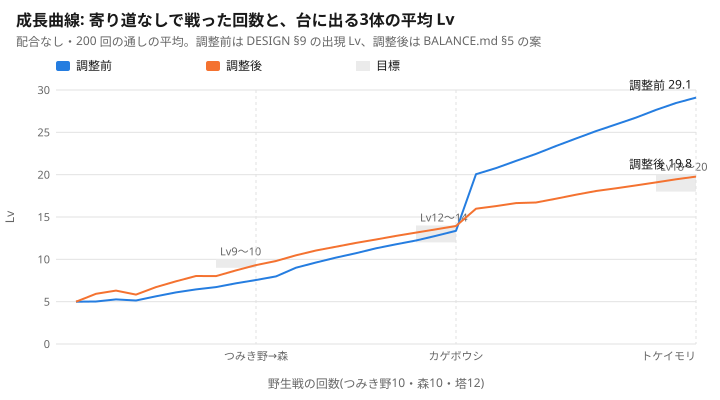
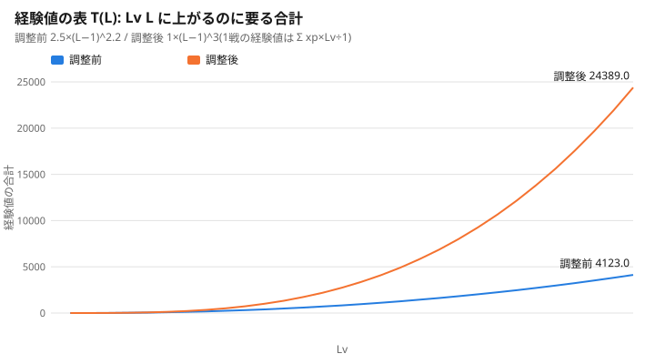
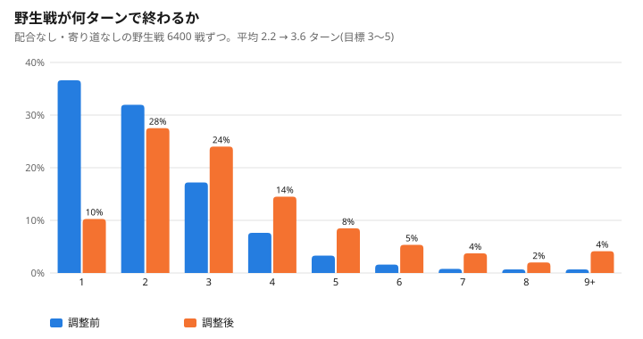
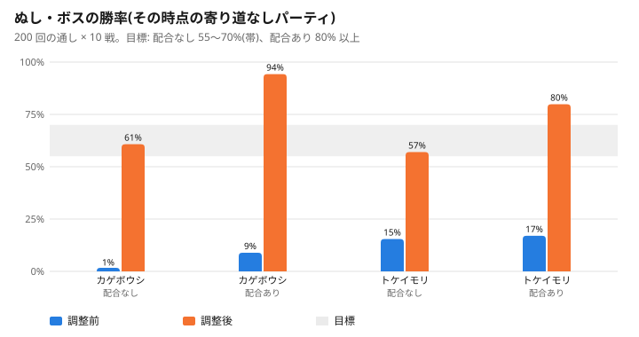
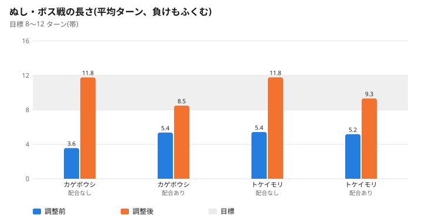
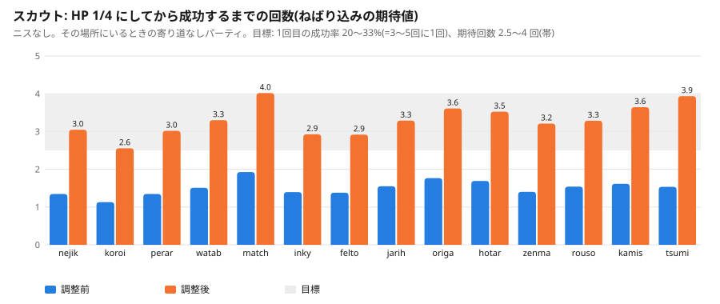
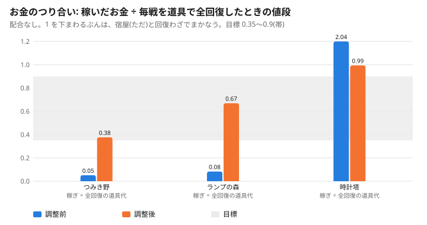
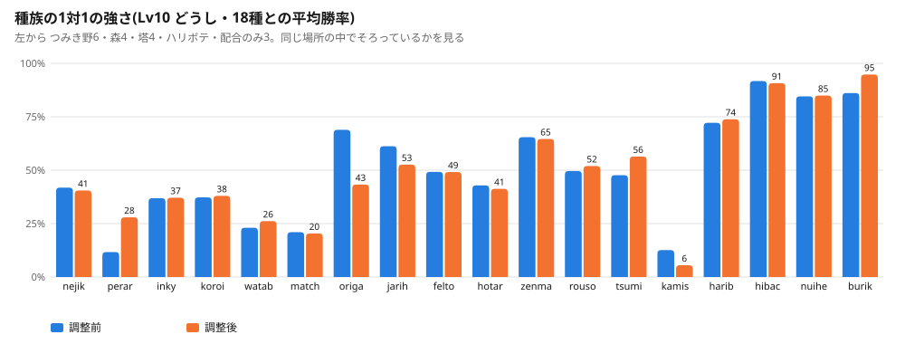

# バランス解析(BALANCE.md)

作成: 2026-11-28 / balancer バランス解析班 / 元: DESIGN §3・§4・§9・§10、ISSUES の申し送り(戦闘が1〜3ターンで終わる・ぬしに勝てない)

> 勘ではなく、`data/*.json` と `src/core/` をそのまま動かすモンテカルロで決めた。数字はすべて
> `node tools/sim/balance_report.mjs --runs 200 --boss 10` で出し直せる(約15秒。グラフと表は `docs/balance/` に書き出す)。

## 0. まとめ

| | 調整前 | 調整後 | 目標 |
|---|---|---|---|
| 野生戦の長さ(寄り道なし・配合なし) | 平均 2.2 ターン(37% が1ターン) | **平均 3.6 ターン** | 3〜5 |
| カゲボウシ 配合なし / 配合あり | 1% / 9%(3.6 ターン) | **61% / 94%**(11.8 / 8.5 ターン) | 55〜70% / 80%+、8〜12 ターン |
| トケイモリ 配合なし / 配合あり | 15% / 17%(5.4 ターン) | **57% / 80%**(11.8 / 9.3 ターン) | 同上 |
| Lv(台の3体の平均)つみき野後 / カゲボウシ前 / トケイモリ前 | 7.6 / 13.4 / **29.1** | **9.3 / 13.9 / 19.8** | 9〜10 / 12〜14 / 18〜20 |
| スカウト(HP 1/4 の1回目) | 48〜88%(ほぼ1回) | **21〜35%**(期待 2.6〜3.9 回) | 3〜5回に1回 |
| 稼ぎ ÷ 全回復の道具代(つみき野 / 森 / 塔) | 0.05 / 0.08 / 2.06 | **0.38 / 0.67 / 0.99** | 0.35〜0.9 |

一番大きかった原因は3つ:

1. **ダメージの係数**(pow ÷ 16)が HP に対して大きすぎた。弱点×素材ぞろい = 1.8倍が乗ると一撃。→ **÷ 28**
2. **ぬし・ボスが強すぎた**。トケイモリは learn に じこくのかね(全体・威力64)が入っていて、12時以外も毎ターン撃っていた(データの不具合)。手下のゼンマイヌ Lv16 は台の味方より強く、2回補充。カゲボウシは すいとり(かしこさ17)が一撃級で、かげのマント+影のターンで物理がほぼ当たらない。
3. **カゲボウシの経験値**(xp 160 × Lv14 ÷ 3 = 746)が森全体より多く、塔の終わりで **Lv29**(上限近く)になっていた。経験値の表も平らすぎて、塔で上がりすぎる。

## 1. 目標(決めたこと)

| 項目 | 目標 |
|---|---|
| 時間 | 寄り道なしで約60分(野生戦 32 戦 × 約35秒 + ぬし2戦 × 約2分 ≒ 23分。残り約37分が謎解き・会話・移動) |
| 野生戦 | 平均 3〜5 ターン。寄り道なし・道具を使わない自動戦闘で、負けは 1 エリア 10% 前後まで(人は道具・弱点・いれかえを使うので、もっと少ない) |
| ぬし・ボス | 戦う時点の **寄り道なしの平均的なパーティ** で、配合なし 55〜70%、配合あり 80% 以上。8〜12 ターン |
| 経験値 | 台の3体の平均で、つみき野の終わり Lv9〜10(Lv10 で配合が解禁)、カゲボウシ前 Lv12〜14、トケイモリ前 Lv18〜20 |
| スカウト | 相手の HP 1/4 以下で、1回目の成功が 20〜33%(3〜5回に1回)。ねばり込みで 2.5〜4 回。ニスで 2 回前後 |
| お金 | 稼ぎ ÷「毎戦を道具で全回復したときの値段」が 0.35〜0.9。足りないぶんは宿屋(ただ)と回復わざ。終盤ほど道具で回せる |
| 種族 | 同じ場所に出る種族どうしで、1対1の強さが大きくずれない(配合のみ・ハリボテは上) |

## 2. 「寄り道なしの平均的なプレイヤー」の決めごと(`tools/sim/progress_sim.mjs`)

- 最初の1体は ネジコ / ペラリ / インキー から等しく選ぶ。**Lv5**(DESIGN に書かれていないので balancer が決めた。§6)
- 野生戦: つみき野 10・森 10・塔 12(塔は各階2〜3)。スカウトは つみき野2・森1・塔1(配合ありは つみき野・森で1体ずつ多く)
- 毎戦、いちばん強い3体を台に出す。4体目からは控え(経験値半分)。戦い方は両方とも `battle.js` の `autoAction`(期待ダメージ最大を7割)
- 戦闘のはじめは満タン(宿屋・道具で回復した前提)。へったHPを道具の値段に直して「全回復の道具代」とする(MP は宿屋)
- 配合あり: 村にもどったとき(Lv10 が2体いなければ森の途中で)1回目、カゲボウシのあとに2回目。ネジコ×マッチボウがいればそれ、なければいちばん強い1体を残して弱い2体。おさがり1か所・攻撃わざ2つを受けつぐ
- ぬし戦は、その時点のパーティを 10 回ずつ戦わせる。200 回の通し × 配合なし/あり

## 3. 調整したもの

### 3-1. core の定数(式の形は DESIGN のまま。値は `TUNE` `GROW` `BOSS` にまとめた)

| 場所 | 定数 | 前 | 後 | 理由 |
|---|---|---|---|---|
| battle.js `TUNE.powDiv` | 基本 = pow ÷ **powDiv** × A²÷(A+D) | 16 | **28** | 1発が HP の 40〜100% → 15〜45%。16〜40 をふって、野生 3〜5 ターン・ぬし 8〜12 ターンに入るのが 28 |
| stats.js `GROW.xpA / xpP` | T(L) = xpA × (L−1)^xpP | 2.5 / 2.2 | **1 / 3** | 2.2 は平らすぎて、出現 Lv の高い塔で上がりすぎる。3 乗なら「つみき野:森:塔」の必要量の比が、もらえる量の比とそろう |
| stats.js `GROW.xpDiv` | 経験値 = Σ xp × Lv ÷ xpDiv | 3 | **1** | 表を大きくしたぶん |
| stats.js `GROW.goldDiv` | お金 = Σ gold × Lv ÷ goldDiv | 5 | **2** | 序盤の稼ぎが道具代の 5% しかなかった |
| battle.js `BOSS.kageboushi` | Lv / 手下 Lv | 14 / オリガラス 11 ×2 | **13 / 9 ×2** | |
| battle.js `BOSS.tokeimori` | Lv / 手下 Lv / 補充 | 20 / ゼンマイヌ 16 ×2 / 2回 | **19 / 12 ×2 / 1回** | 手下が台の味方より強かった |

ほかの定数(弱点 1.5・いまひとつ 0.67・素材ぞろい 1.2・後列 0.7・全体 0.75・急所・影のターン)は変えていない(仕様書 §6-1 の 1.5 / 0.67 を守る)。

### 3-2. data の数字(`tools/sim/tuning.mjs` に全部の差分。`node tools/sim/tuning.mjs --write` で data に書く)

| 種族 | 変えたもの | 理由 |
|---|---|---|
| ペラリ | base atk 11→14・int 16→12・hp 30→32・def 10→11・mp 20→18、learn: おりたたみ Lv16→12 | わざが物理ばかりなのに かしこさ型で、最初の3体の中でとびぬけて弱かった |
| コロイシ | base hp 40→43・atk 15→14・def 20→16・spd 7→8・int 6→7、ころがる Lv3→6 | Lv5 のネジコ(最初の1体)が Lv3 のコロイシに勝率 7%(÷28 にしても 36%)(A²÷(A+D) でまもり20が効きすぎ) |
| ワタボウシ | atk 11→13・def 9→10・spd 20→18・mp 16→14・hp 30→31 | 攻撃が弱すぎた |
| マッチボウ | hp 29→32・def 10→11・int 13→11 | つみき野でいちばん弱かった |
| オリガラス | atk 17→15・spd 19→17・def 11→12・int 11→13、おりたたみ Lv10→14 | 森の影の群れで負けが 23%。1対1で森の中でとびぬけていた |
| ジャリヘビ | atk 18→16・int 10→12 | 同じ |
| ゼンマイヌ | atk 19→17・int 9→11 | 塔の手下として強すぎた |
| カゲボウシ | atk 16→13・spd 18→15・int 17→12、hpMul 3.5→**2.2**、xp 160→60、gold 120→50 | すいとりが一撃級。HP が多すぎて 4 ターンで負けていた |
| トケイモリ | atk 19→14・def 21→17・spd 15→13・int 16→10、hpMul 5→**3**、learn から じこくのかね をはずす(12時に強制で撃つので要らない) | 毎ターン全体攻撃していた不具合を直す |
| 経験値 xp | つみき野 12〜16→17〜21、森 15〜18→12〜13、塔 24〜26→15〜16 | 成長曲線を目標の帯に入れる(§4-1) |
| お金 gold | つみき野 5〜7→9〜11、森 6〜8→9〜10、塔 10〜12→7〜8 | 稼ぎの比を 0.35〜0.9 に |
| スカウト scout | 0.25〜0.55 → **0.10〜0.22**(ハリボテ 0.1) | ほぼ1回で入っていた |
| わざ | つくろい 威力 40→30、おおつくろい 28→20 | ダメージを ÷28 にしたので、回復が相対的に 1.75 倍になったぶんを戻す |

道具の値段は変えていない(ばんそうこう 20 で 45 回復は、稼ぎを上げたあとでちょうどよい)。

## 4. 結果

### 4-1. 成長曲線

### 4-2. 野生戦の長さ

1体だけの群れ(35〜80%)は 1〜2 ターンで終わるので、分布の山は 2〜4。平均と中央は 3〜4 に入った。

### 4-3. ぬし・ボス

### 4-4. 数字の表

| 項目 | 調整前 | 調整後 |
|---|---|---|
| 配合なし: Lv(つみき野の後 / カゲボウシ前 / トケイモリ前)※台の3体の平均 | 7.6 / 13.4 / 29.1 | 9.3 / 13.9 / 19.8 |
| 配合なし: いちばん強い1体の Lv(同) | 8.5 / 14.5 / 29.6 | 10.4 / 14.6 / 20.8 |
| 配合なし: 野生戦の平均ターン(10%〜90%) | 2.2(1〜4) | 3.6(1〜6) |
| 配合なし: 野生戦の負け(つみき野 / 森 / 塔) | 27% / 23% / 0% | 11% / 7% / 4% |
| 配合なし: カゲボウシ 勝率・ターン | 1%・3.6 | 61%・11.8 |
| 配合なし: トケイモリ 勝率・ターン | 15%・5.4 | 57%・11.8 |
| 配合なし: 稼ぎ(つみき野 / 森 / 塔) | 51 / 168 / 700 | 253 / 759 / 1221 |
| 配合なし: 全回復の道具代(同) | 999 / 2016 / 343 | 671 / 1134 / 1228 |
| 配合あり: Lv(つみき野の後 / カゲボウシ前 / トケイモリ前)※台の3体の平均 | 8.3 / 13.7 / 29.1 | 10.0 / 13.7 / 19.8 |
| 配合あり: いちばん強い1体の Lv(同) | 9.1 / 15.0 / 29.6 | 10.8 / 14.6 / 20.9 |
| 配合あり: 野生戦の平均ターン(10%〜90%) | 2.1(1〜4) | 3.2(1〜6) |
| 配合あり: 野生戦の負け(つみき野 / 森 / 塔) | 21% / 14% / 0% | 7% / 7% / 2% |
| 配合あり: カゲボウシ 勝率・ターン | 9%・5.4 | 94%・8.5 |
| 配合あり: トケイモリ 勝率・ターン | 17%・5.2 | 80%・9.3 |
| 配合あり: 稼ぎ(つみき野 / 森 / 塔) | 59 / 191 / 692 | 284 / 790 / 1265 |
| 配合あり: 全回復の道具代(同) | 1035 / 1627 / 228 | 589 / 1108 / 920 |

`tools/sim/battle_sim.mjs --preset all`(実装班の節目 + balancer が足した「平均的なパーティ」4つ):

| battle_sim の節目 | 調整前 勝率・ターン | 調整後 勝率・ターン |
|---|---|---|
| つみき野の入口(Lv3 の最初の1体 vs 野生3体) | 0%・1.3 | 0%・3.4 |
| つみき野の終わり(Lv9×3 vs 北東の群れ) | 100%・2.5 | 99%・3.7 |
| 森の中(Lv12×3 vs 中の群れ) | 100%・4.3 | 100%・4.6 |
| ぬし カゲボウシ(Lv14×3) | 25%・5.7 | 100%・4.2 |
| ぬし カゲボウシ(配合なし Lv14×3) | 0%・2.7 | 18%・10.9 |
| 塔の5階(Lv18×3 vs ツミキングたち) | 100%・2.5 | 100%・3.2 |
| ボス トケイモリ(Lv20×3) | 2%・3.6 | 100%・5.6 |
| ボス トケイモリ(配合なし Lv20×3) | 0%・3.5 | 66%・9.2 |
| ぬし カゲボウシ(平均・配合なし: 最初の1体+つみき野2+森1) | 0%・3.5 | 71%・12.1 |
| ぬし カゲボウシ(平均・配合あり: ヌイヘビ b0.1 入り) | 3%・5.9 | 100%・7.9 |
| ボス トケイモリ(平均・配合なし) | 0%・3.4 | 39%・12.6 |
| ボス トケイモリ(平均・配合あり) | 0%・4.3 | 99%・7.4 |

- 「配合なし Lv14×3」(ネジコ・コロイシ・ペラリ)が 18% なのは、つみき野の3種だけ・控えなしの、平均より弱いパーティだから。森で1体スカウトした平均的なパーティ(下の4行)では 71%
- 「Lv20×3 配合あり」の 100% は、配合のみの3種を Lv20 までそろえた寄り道ありの形。寄り道なしの配合あり(1〜2回)は 80〜94%
- 「つみき野の入口 Lv3 vs 3体」は、群れの数の案(§5)では起きない(入口は1体ずつ)

ダメージの例(乱数1・急所なし):

| 攻撃 | わざ | 受ける側 | 調整前 ダメージ/HP | 調整後 ダメージ/HP |
|---|---|---|---|---|
| ネジコ Lv5 | たいあたり | コロイシ Lv4 | 16 / 54(4発) | 10 / 58(6発) |
| コロイシ Lv4 | たいあたり | ネジコ Lv5 | 18 / 47(3発) | 9 / 47(6発) |
| コロイシ Lv4 | ころがる | ネジコ Lv5 | 50 / 47(1発) | 26 / 47(2発) |
| マッチボウ Lv7 | ひのこ | ペラリ Lv6 | 40 / 45(2発) | 19 / 48(3発) |
| ロウソクン Lv10 | ひのこ | ペラリ Lv10 | 89 / 57(1発) | 54 / 60(2発) |
| ヒバチネコ Lv14 | かえんぐるま | カゲボウシ Lv13(ぬし) | 161 / 416(3発) | 93 / 250(3発) |
| カゲボウシ Lv13 | かげふみ | ネジコ Lv14 | 58 / 78(2発) | 22 / 78(4発) |
| カゲボウシ Lv13 | すいとり | ネジコ Lv14 | 57 / 78(2発) | 18 / 78(5発) |
| ブリキシ Lv20 | きしのとつげき | トケイモリ Lv19(ぬし) | 267 / 925(4発) | 169 / 537(4発) |
| トケイモリ Lv19 | じこくのかね | ブリキシ Lv20 | 83 / 139(2発) | 20 / 139(7発) |
| トケイモリ Lv19 | はぐるまのこ | フェルトン Lv20 | 248 / 116(1発) | 84 / 116(2発) |

### 4-5. スカウト

| 場所 | 種族 | Lv | scout 前→後 | 1回目の成功率 前→後 | 期待回数 前→後 | ニスあり(後) |
|---|---|---|---|---|---|---|
| tsumiki | nejiko | 3 | 0.5→0.2 | 72%→29% | 1.3→3.0 | 2.0 |
| tsumiki | koroishi | 3 | 0.55→0.22 | 88%→35% | 1.1→2.6 | 1.7 |
| tsumiki | perari | 3 | 0.5→0.2 | 72%→29% | 1.3→3.0 | 2.0 |
| tsumiki | watabou | 4 | 0.5→0.2 | 63%→26% | 1.5→3.3 | 2.2 |
| tsumiki | matchbo | 5 | 0.4→0.17 | 48%→21% | 1.9→4.0 | 2.6 |
| forest | inky | 9 | 0.45→0.19 | 70%→30% | 1.4→2.9 | 1.9 |
| forest | felton | 9 | 0.45→0.19 | 71%→30% | 1.4→2.9 | 1.9 |
| forest | jarihebi | 10 | 0.42→0.18 | 62%→27% | 1.6→3.3 | 2.2 |
| forest | origarasu | 11 | 0.4→0.17 | 54%→24% | 1.8→3.6 | 2.4 |
| forest | hotarubin | 11 | 0.4→0.17 | 57%→25% | 1.7→3.5 | 2.3 |
| tower | zenmainu | 14 | 0.38→0.17 | 69%→27% | 1.4→3.2 | 2.1 |
| tower | rousokun | 14 | 0.38→0.17 | 62%→27% | 1.5→3.3 | 2.2 |
| tower | kamishibai | 15 | 0.35→0.16 | 59%→24% | 1.6→3.6 | 2.4 |
| tower | tsumiking | 16 | 0.35→0.16 | 63%→22% | 1.5→3.9 | 2.6 |

### 4-6. お金

カゲボウシ前の所持金(使わなかった場合)は 147 → 867、トケイモリ前は 1209 → 2208。森で ばんそうこう・オイル・ニスを数個ずつ買えて、塔で大きなばんそうこう・まるごとスプレーに手がとどく。

### 4-7. 種族の強さ

## 5. 出現の案(areas は直さない。ジオラマ大工への申し送り)

マップは作り直し中なので、`data/areas/` は直していない。シミュレーターは下の表(`ROUTES.proposal`)で測った。

| エリア | 場所 | 出現 Lv 前 → **案** | 群れの数(1体/2体/3体) |
|---|---|---|---|
| つみき野 | 入口 | 2〜4 → **2〜3** | **1体だけ**(最初の1体ひとりで戦うので) |
| | 西の野 | 3〜6 → **3〜4** | 80% / 20% / 0 |
| | 東の野 | 4〜7 → **4〜6** | 80% / 20% / 0 |
| | 回転台の上 | 5〜7 → 5〜7 | 80% / 20% / 0 |
| | 北西・北東 | 6〜9 → **6〜8** | 50% / 40% / 10% |
| ランプの森 | 西 | 7〜10 → **8〜10** | 40% / 40% / 20% |
| | 中 | 8〜11 → **9〜11** | 同 |
| | 影の中 | 9〜12 → **10〜12** | 同 |
| | 東 | 9〜12 → **10〜13** | 同 |
| 時計塔 | 1階 | 11〜13 → **13〜14** | 40% / 40% / 20% |
| | 2階 | 12〜14 → **14〜15** | 同 |
| | 3階 | 13〜15 → **15〜16** | 同 |
| | 4階 | 14〜16 → **15〜17** | 同 |
| | 5階 | 15〜17 → **16〜18** | 30% / 45% / 25% |

- 森・塔の出現 Lv を上げたのは、経験値の表を3乗にしたので、Lv の差で経験値の量をつける方がきれいだから
- 群れの数は DESIGN に書かれていない。野生戦は「シンボル1体にふれると 1〜3 体が出る」として、この割合を `field` / `main.js` の班で使ってほしい
- カミシバイ2体+ツミキングの群れは、カミシバイがかみふぶき(Lv18)を覚えていると強い。かみふぶきを早める調整はやめた(塔3階の負けが 21% になった)

## 6. 式の形を変えたい案(変えていない。ISSUES.md に同じものを書いた)

1. **最初の1体の Lv** を 5 に決めてほしい(story / main の班)。Lv3 だとつみき野の入口で負けが目立つ
2. **野生の敵の AI** を少しゆるく(期待ダメージ最大を 7割 → 5割)。人はもっと上手に戦うので今のままでもよいが、通しの自動テストで負けを減らせる
3. **A²÷(A+D)** は、まもりが高い相手に弱い攻撃役が何もできなくなる形(コロイシ問題)。`A × A ÷ (A + 2D) × 3` のような形にすると、まもりの効き方がゆるくなる。今回は種族の数字で直した
4. 回復わざ `pow × (1 + かしこさ ÷ 40)` は Lv とともに伸びが大きい。`healDiv` を `TUNE` に出したので、終盤の回復が強すぎたら 40 → 60

## 7. 道具(tools/sim/)

| ファイル | 中身 |
|---|---|
| `battle_sim.mjs` | 2チームの勝率(実装班のもの。`db` を渡せるようにし、平均的なパーティの節目を4つ足した) |
| `progress_sim.mjs` | **寄り道なしの通しプレイ**(成長・野生戦・負け・お金・道具代・配合・ぬし戦) |
| `matchup.mjs` | 1対1の相性表(同じ Lv の18種) |
| `scout_sim.mjs` | スカウトの成功率と期待回数 |
| `damage_examples.mjs` | ダメージの例 |
| `tuning.mjs` | 調整の差分(data に書く・メモリの上で試す) |
| `balance_report.mjs` | 調整前(git の 507e212)と後を比べて、`docs/balance/*.svg`・`report.json`・`tables.md` を書く |
