# BALANCE: 統合版の測り直しと調整

作成: バランス解析班(balancer) 2026-11-18

3つの時点を並べます。

- **改修前**: 古い main(`a4df3ae`)。T1〜T6 が入る前。最初に測った基準値(この文書の前の版)。
- **調整前**: T1 天気・T2 寄り道ボーナス・T3 きらり・T4 地域図鑑・T6 序盤補正が統合された版(コミット `c34fad2`)を、そのまま測ったもの。`tools/sim/out_before/` に JSON があります。
- **調整後**: この班が数値を直した版(`tools/sim/out/`)。

測りかた: Playwright でゲームを開き、ゲーム本物の関数(`owArrive` `owEncounter` `startBattle` `autoTurn` `win` `lose` `scoutP` `H.boss` `wxOf` `footInfo` `regList` など)をそのまま動かして、モンテカルロで数えました。ゲームのソースは書き換えていません。乱数は種(seed=1)で固定。オート戦闘の AI は手で操作するより弱めなので、勝率は「下限に近い」値です。
今回、天気は日付で決まるので、**ゲームごとに乱数で天気をふる**ようにシミュレータを直しました(これまでの測定は、ある1日の天気だけで測っていました)。メタルに逃げられた戦闘は、勝ち負けに数えません。

## 0. 結果の一覧(目標・改修前・調整前・調整後)

| # | 項目 | 目標 | 改修前 | 調整前(統合版) | 調整後 | 判定 |
|---|---|---|---|---|---|---|
| 11a | 最初の草むら・初戦の勝率(イボテ/ハッパ/ヤモリュ) | 95%以上 | 20 / 45 / 48% | 65 / 95 / 94% | **99.1 / 99.3 / 99.2%**(95%信頼区間の下限 98.3%) | ○ |
| 11b | 4戦目以降(相棒1体のまま) | 85%以上 | 26 / 59 / 60% | 20 / 53 / 54% | **85 / 89 / 88%** | ○ |
| 11b' | 4戦目以降(3体) | 85%以上 | 96 / 99 / 99% | 93 / 97 / 97% | 97 / 97 / 97% | ○ |
| 12 | 裏山(3体・先頭Lv5/6/7) | 60〜80% | 56〜84% | 58 / 66 / 82% | **61 / 68 / 80%** | ○ |
| 13 | ぬしを倒すまで(3体・中央値) | 早すぎず・育てれば勝てる | 38〜48分 | 43〜49分・初見で勝てる人 0〜6% | **24〜27分**・Lv14で挑むと初見で61% | ○ |
| 13b | ぬしの勝率(3体・Lv14 / Lv18) | Lv14で5割前後 | 2% / 36% | 2% / 36% | **50% / 95%** | ○ |
| 1 | 天候限定7体に狙って出会う(平均) | 10分以内 | – | 2〜6分(ホシクズメ 25〜53分) | **5〜10分**(ホシクズメ 7〜14分) | ○ |
| 1' | 狙わずに戦い続けたとき | 約1時間に1回 | – | 8〜28分(ホシクズメ 250〜840分) | **16〜40分**(ホシクズメ 50〜129分) | △(少し多め) |
| 3 | きらりを目にする間隔(歩きだけの時間) | 2〜3分に1回 | – | 約1分に1回 | **約2.3分に1回**(寄り道最大で約1.5分) | ○ |
| 4 | 色違い/時(草むら100%・通常+きらり+星降り) | 0.5〜1回 | 0.7〜1.1(通常のみ) | 約1.0〜1.5 | **1.0〜1.4**(草むら4割の実プレイなら 0.4〜0.6) | △ |
| 7 | 寄り道ボーナス(段5)の倍率(大楠の迷い森・Lv16) | 1.3〜1.5倍、2倍まで | – | 経験値 1.33・円 1.34 | 同じ(式どおり 1+0.1×段) | ○ |
| 8 | 才能のかけらに届く時間 | 序盤は数十分 | 80点 = 3分 | 80点 = 3分 | **300点 = 15分** | ○ |
| 8' | 天賦の宝珠 | 全マップの7〜8割 | 400点(総点の9%・21分) | 400点(同) | **3000点**(総点の68%・全マップを順に歩いて2.2時間) | ○ |
| 9 | 流星石の新しい入り口(1回きり) | ガチャを安くしない | – | ★485(天井★10000 の5%) | 同じ。みちくさ帳は1日★10→**★5** | ○ |
| 10 | 負けの罰(裏山Lv8・3体、ぬし後) | 道具の価格帯と釣り合う | 円の増え −19/時 | +39/時 | +18/時(つり合う所持金 約640円。旧ルールだと約320円) | △ |
| 6 | 地域図鑑のコンプ(1町・中央値) | 30〜60分 | – | こもれび 109分・霞ヶ丘 105分ほか | **こもれび 62分**・霞ヶ丘 42分・ほか 14〜51分 | ○ |
| 5 | メタル系を1体倒すまで | 1時間前後 | 約3.8時間 | 約6時間(倒す率が下がっていた) | **約1.3時間**(コガネツブの倒す率 9%→27%) | ○ |

○=目標内、△=目標の近く(理由は各節)。

---

## 1. 変えた数値の一覧

`src/game.html`(と、歩けるマップの部分は `src/parts/overworld.js` に反映済み)。セーブのキーは増やしていません。

| 数値 | 場所 | 調整前 | 調整後 | 理由 |
|---|---|---|---|---|
| イボテの Lv1 の技 | `S('ibote')` の skills | まぼろしほうし だけ | **ほうしだん(新技・MP2・魔法11・毒25%)を足した** | Lv1 に攻撃技がなく、3体のなかで1人だけ初戦の勝率が65%だった |
| 最初の1戦の敵Lv | `owEarly` | 先頭Lv−1 | **先頭Lv−2**(2戦目と3戦目は−1のまま) | 初戦 94〜95% → 99%。負けの原因はLv2の アメザリ・ハスノハ・ウリボウ |
| 3勝したあとの敵の数 | `owEarly`(あぜ道だけ) | 2〜3体に戻る | **なかまが先頭1体だけのあいだは1体・Lv−1** | 相棒1体のまま4戦目以降が 53% だったのを 88% に。裏山には補正なし |
| 天候限定の重み | 出現表への追加 | アマヤドリ2 / キリガラス2.5 / ニジミミズ1.5 / ユキワタ2・1.5 / ハイカグラ2.5・1.5 | **0.8 / 0.6 / 0.5 / 0.5・0.4 / 0.6・0.4**(クモリスミ2は据え置き) | 狙わずに戦い続けると8〜19分ごとに出ていた。多すぎ |
| 星降りの重み `WX_TBL.hoshi` | `WX_TBL` | 2〜8 | **16〜39**(こもれび 4→26 など) | 星降りの夜が夜の4%しかなく、ホシクズメを狙っても平均53分(時間送り130回)かかった |
| ホシクズメの重み | 出現表 | 1.5 | **1.5(据え置き)** | 星降りの夜1回に会える回数は、こもれび町で約1.3回。多すぎも少なすぎもなし |
| きらりの出る確率 `owKirariProb` | `owKirariProb` | 0.20 | **0.08** | 歩きだけで約55秒ごとにきらりが出ていて、拾いに行くのが仕事になる。目標は2〜3分 |
| 低い出現重み | 出現表 | マンドラ.4 / カブトオ.4 / ヒトダマ.6 / ハスノハ.6 / ユキムシ.8 | **.8 / .8 / 1 / 1 / 1.2** | こもれび町のコンプが109分(30〜60分の目標の倍)。出にくい種族がじゃま |
| ぬし(こもれび町)のLv・HP倍率 | `TOWNS.komorebi.boss`・`startBattle` | Lv12・HP×1.6 | **Lv10(表の8)・HP×1.2**(`boss.hpx` を新設) | 3体 Lv14 で勝率2% → 50% |
| メタル系の逃げる確率 | `METAL_FLEE` | 35%/ターン | **15%** | 倒す率が3〜5%。1体倒すのに3.8〜6時間 |
| メタル系にふつうの攻撃が通る確率 | `METAL_HIT` | 50%で1ダメージ | **必ず1ダメージ** | 同上。2つ合わせて、倒す率がコガネツブで 9%→27% |
| みちくさ帳: 才能のかけら | `MEX` | 80点 | **300点** | 80点は3分で貯まる。1日1回なので、15分に1個が上限に |
| みちくさ帳: 流星石 | `MEX` | ★10(50点) | **★5(50点)** | ログイン+ミッション(1日19)に、さらに+10は5割増しになる |
| みちくさ帳: 天賦の宝珠 | `MEX` | 400点 | **3000点** | 全マップの総点4,428の68%。400点は9%で、タワーやライバルの賞品より安かった |
| 「みちくさ名人」の称号 | `mchiTitle` | 累計1000点 | **累計2500点** | 1000点は全マップの2割で届く。称号は後半の目印にする |

テストは3か所を、意図を保ったまま書き換えました(`tools/test/run.js`): みちくさ帳の交換テストの値(価格は `MEX` から読む)、称号の境目 2500、T6 の「はじめの1戦は−2・あぜ道で仲間1体のあいだは敵1体」。45件すべて通ります。

---

## 2. 序盤の勝率(DESIGN 5-3 の 11)

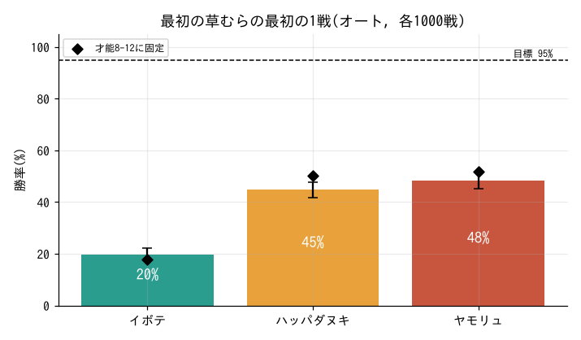
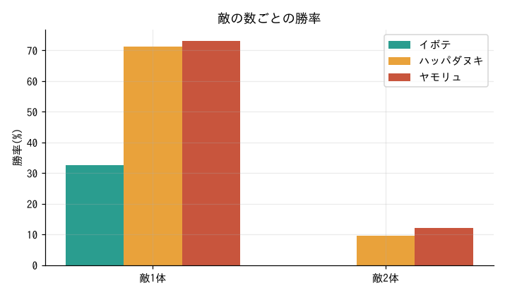
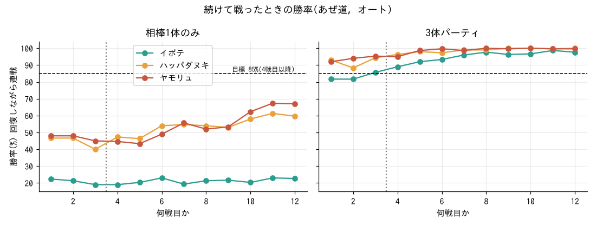

- **目標**: 初戦 95%以上、4戦目以降 85%以上。
- **改修前**: イボテ 20%、ハッパダヌキ 45%、ヤモリュ 48%。イボテに Lv1 の攻撃技がないこと、敵2体戦がほぼ全敗だったことが原因。
- **調整前(T6 入り)**: 敵が1体になった(T6 の効果)ので 65 / 95 / 94%。ただしイボテだけが 65% のまま、ハッパ・ヤモリュも 95% ぎりぎり(信頼区間の下限 93%)。相棒1体のまま4戦目以降は 20 / 53 / 54% で、**3勝で補正が切れると、また負け続ける**。
- **調整後**: 初戦 99.1 / 99.3 / 99.2%(各1000戦)。才能 (8,12) 固定でも 99%。4戦目以降は、相棒1体のまま 85 / 89 / 88%、3体 97%。
- **変えたもの**: イボテにほうしだんを足した(65→92%)。初戦だけ敵Lvを先頭−2に(92→99%)。あぜ道で、なかまが先頭1体のあいだは敵1体・Lv−1(4戦目以降 53→88%)。
- 2戦目・3戦目の勝率は 86〜95% です(初戦だけ特別に強く守っています)。

### 裏山(DESIGN 5-3 の 12)


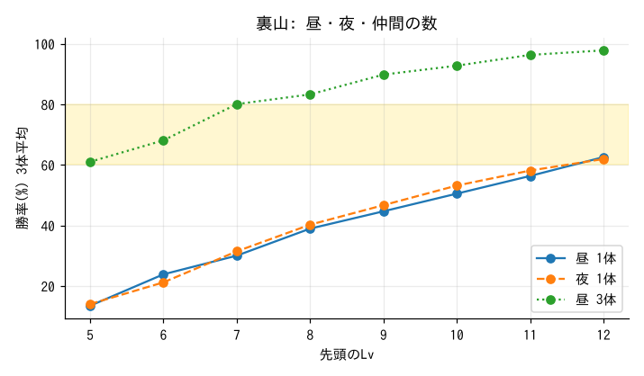

3体のときの勝率(3人の相棒の平均、各点200戦): 先頭Lv5 **61%**、Lv6 **68%**、Lv7 **80%**、Lv8 83%、Lv10 93%。目標の 60〜80% は Lv5〜7 で満たしています。調整前(58 / 66 / 82%)とほぼ同じで、**裏山には補正をかけていません**(イボテの技の分だけ、イボテの勝率が2〜10ポイント上がっただけ)。相棒1体で行くと 13〜51%(Lv5〜10)で、夜も昼と変わりません(−2〜+2ポイント)。

### こもれび町のぬし(DESIGN 5-3 の 13)


| | 改修前 | 調整前 | 調整後 |
|---|---|---|---|
| 3体・倒すまで(中央値) | 43〜49分・83〜87戦 | 同(Lv11で初挑戦して勝てた人 0〜6%) | **24〜27分・42〜44戦** |
| 初挑戦で勝てる(3体・Lv14で挑戦) | 6% | 6% | **61%** |
| 挑戦回数の平均(3体) | 3.6〜6.4回 | 同 | 1.6〜4.1回 |
| ぬし戦の勝率(3体・満タン、Lv10 / 14 / 18 / 22) | 0 / 2 / 36 / 80% | 同 | **1 / 50 / 95 / 100%** |
| 相棒1体で6時間以内に倒せる | 17〜22% | 17〜22% | **72〜83%**(約107分・Lv24前後) |

ぬしは Lv12・HP×1.6 でした。Lv10・HP×1.2 にして、3体で Lv14 なら半々、Lv16〜18 でほぼ勝てるようにしました(オート AI での値。手で操作すれば、もう少し楽になります)。「育てれば勝てる」を、Lv差で作った形です。他の町のぬし(HP×1.6)は触っていません。

---

## 3. 新しい仕組みの測定

### 3-1. 天候限定7体に出会うまで(DESIGN 5-1 の 1)

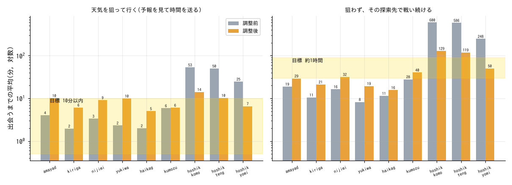

`node tools/sim/run.js wxfind`。**狙う**: 予報を見て、その種が出る天気・時間帯になるまで草むらの外を歩いて(120歩=22秒で1時間帯)時間を送り、出る時間帯だけ戦う。**狙わない**: 天気を気にせず、その探索先で戦い続ける(戦闘は 18秒+回復の往復で換算)。各100回。

| 種族(場所) | 狙う: 調整前 → 調整後(分) | 狙わない: 調整前 → 調整後(分) |
|---|---|---|
| アマヤドリ(あぜ道・雨) | 4 → **10** | 19 → **29** |
| キリガラス(杉林・霧) | 2 → 6 | 11 → 21 |
| ニジミミズ(路地裏・雨) | 3 → 9 | 16 → 32 |
| ユキワタボウシ(原生林・雪) | 2 → 10 | 8 → 19 |
| ハイカグラ(溶岩の浜・灰) | 2 → 5 | 11 → 16 |
| クモリスミ(夜の漁港・くもりの夜) | 6 → 6 | 28 → 40 |
| ホシクズメ(こもれび町・星降りの夜) | 53 → **14** | 842 → **129** |
| ホシクズメ(天狗岳) | 50 → 10 | 586 → 119 |
| ホシクズメ(黄泉ヶ原) | 25 → 7 | 248 → 50 |

- 目標は「狙えば10分以内、狙わなければ約1時間」。**狙う方は、全7体が10分以内**(ホシクズメは調整前が53分で目標外だった)。
- 狙わない方は、調整前は8〜28分で、天候限定が「ふつうに出る種族」になっていました。重みを下げて 16〜40分にしました。1時間まで下げなかったのは、重みを下げるほど、狙っても出会いにくくなる(10分の目標が崩れる)ため。ここが目標との差(△)です。
- 星降りの夜は、夜の4%(重み4/104)しかありませんでした。星降り(夜だけ)の重みを5〜6倍にしました(こもれび 4→26 で、夜の約2割)。あまり多くしないのは、星降りに「きらり3倍・色違い2倍」が付くためです。
- **ホシクズメの重み1.5は妥当**です。星降りの夜1回(約13戦)に会える回数は、重み1で 0.9回、1.5で 約1.3回、2 で 1.7回、3 で 2.4回(こもれび町、`hoshiw` の結果)。Aランクで、スカウトに失敗することもあるので、1回会えて足りるように、1.5を据え置きました。

### 3-2. きらり・色違い・寄り道ボーナス(DESIGN 5-1 の 3・4、5-2 の 7)

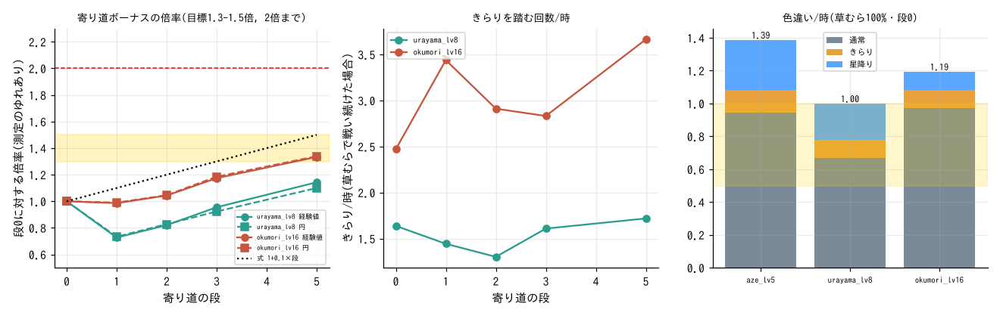

`node tools/sim/run.js bonus`。3体・各12時間。寄り道の段は、測るあいだ固定して、負けたら0に戻って 120秒かけて元の段に戻る、として測りました。きらりは出たらすぐ踏みに行く、として測りました。

**きらり**
- 調整前は、p=0.2 を60歩ごとに引くので、歩きだけなら **約55秒に1回**(DESIGN の目標は2〜3分に1回)。p=**0.08** にして約2.3分に1回。寄り道最大(+50%)で約1.5分、星降りの夜(×3)で約45秒。
- 草むらで戦い続けると、戦闘の時間が大半を占めるため、きらりを踏むのは1時間に 1.6〜3.7回(20〜35分に1回)。
- 上限 0.8 は、0.08×1.5×3=0.36 までなので、**どこでも届きません**(届かなくて安全)。

**色違い(1時間・草むらで戦い続けた場合)**

| 場所(Lv) | 通常 | きらり | 星降り | 計 |
|---|---|---|---|---|
| あぜ道(Lv5) | 0.94 | 0.14 | 0.31 | **1.39** |
| 裏山(Lv8) | 0.67 | 0.11 | 0.22 | **1.00** |
| 大楠の迷い森(Lv16) | 0.97 | 0.11 | 0.11 | **1.19** |

- 改修前は 0.7〜1.1(通常のみ)、調整前は 約1.0〜1.5。**草むらで戦い続ける上限の見積もりは、1.0〜1.4** です。実プレイで草むらにいる時間が4割なら 0.4〜0.6 で、目標 0.5〜1 に入ります(DESIGN の「いまは0.2回」は、この4割以下の見積もりとほぼ合います)。
- 色違い・きらりの確率(通常 1/150、きらり 1/30、星降りきらり 1/15)は、テストで確かめてあるので触っていません。

**寄り道ボーナスあり/なしの倍率**(段5 ÷ 段0、大楠の迷い森・Lv16・3体)

| | 経験値/時 | 円/時 | 1戦あたりの経験値 |
|---|---|---|---|
| 段1 | 0.99 | 0.99 | 1.08 |
| 段2 | 1.04 | 1.05 | 1.18 |
| 段3 | 1.17 | 1.19 | 1.28 |
| 段5 | **1.33** | **1.34** | **1.47** |

- 式は 1+0.1×段(段5=1.5倍)で、**目標 1.3〜1.5 倍の範囲に入り、2倍(きらりが増える分を足しても)を超えません**。時間あたりで 1.33 と少し下がるのは、きらりの遭遇が戦闘を増やす分より、戦闘1回が長くなる分が大きいためです。
- 裏山(Lv8)は、勝率が 83% で負けが多く(13回/時)、負けるたびに寄り道が0に戻って歩き直すので、段1〜3 では 0.73〜0.96倍まで下がります。段5 で 1.14倍。**「負けると寄り道が消える」が、裏山では罰として効いています**(DESIGN どおり)。
- 段が上がる数: 区画 10個で1段なので、段5 には新しい区画が50個要ります。裏山(21区画)だけでは段2まで。大楠の迷い森(80区画)を歩くと段5になります。序盤は最大 +20% で、後半の広いマップで +50% です。調整は不要と判断しました。
- 歩いた区画は2度と数えないので、歩き尽くしたマップでは段が上がらず、倍率は 1.0 に戻ります(DESIGN どおり)。

### 3-3. みちくさ点・交換品(DESIGN 5-2 の 8)

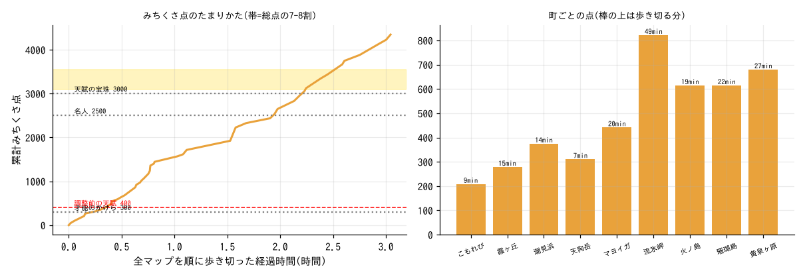

`node tools/sim/run.js points`。本物の `footInfo`(4×4の区画・到達できる区画)で、スポーン地点から「いちばん近い未踏の区画」へ順に歩く最短の巡回の歩数を数え、歩数は×2(迷い・戻り)、草むらの歩数は遭遇(戦闘18秒)を足して時間にしました。

- 全45マップの総点は **4,428点**(区画 3,500弱+80%と100%の分 30点×45マップ+しかけ16種で80点)。全マップを順に歩き切ると約 **3.2時間**。1時間あたり約 1,400点(最初の町は 1,400点/時 前後で、流氷岬のような広い町は 800点/時)。
- 調整前の交換品: 才能のかけら 80点(3分)、天賦の宝珠 400点(21分・総点の9%)。**どちらも安すぎ**(才能のかけらは15,000円相当、天賦の宝珠は全才能+1)。
- 調整後: 才能のかけら **300点(15分)**、天賦の宝珠 **3,000点(総点の68%、2.2時間)**、★は ★5。称号は累計 **2,500点**(総点の56%)。

| 品 | 調整前 | 調整後 | 到達の目安(全マップを順に) |
|---|---|---|---|
| きらきらの砂 | 15点 | 15点 | 1分 |
| 色変わりの貝 | 40点 | 40点 | 2分 |
| 才能のかけら(1日1回) | 80点 | **300点** | 15分(最大 14個) |
| 流星石(1日1回) | ★10 / 50点 | **★5 / 50点** | 3分 |
| 天賦の宝珠(1回だけ) | 400点 | **3000点** | 2.2時間 |
| みちくさ名人 | 累計1000点 | **累計2500点** | 1.9時間 |

- 「1日1回」の上限は妥当です。才能のかけらは 300点なので、1日1個の上限の前に、点がたまる速さで決まります。上限がきくのは、点が余りはじめる後半(2時間目以降)です。
- 天賦の宝珠 3,000点は、新しいマップ(まぼろし駅など)の分が増えると、7〜8割より下がります(総点が増えるため)。まぼろし駅の点が入ったら、`points` を測り直して決め直してください。

### 3-4. 地域図鑑のコンプ(DESIGN 5-1 の 6)

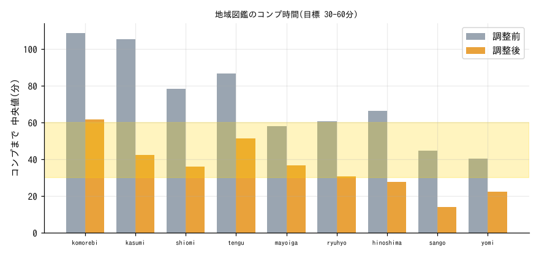

`node tools/sim/run.js region`。その町の出現表と釣り場の全種が対象。いまの時間・天気で足りない種の重みがいちばん多い場所で戦い、出ない時間帯は歩いて時間を送る(予報を見て狙う)。新しい種に会ったらスカウト成功率 70% で仲間になる、と置きました。ホシクズメは、こもれび町でだけ数えます(1体仲間にすれば全町ぶん済むため)。各100回。

| 町(種族数) | 調整前(分) | 調整後(分) |
|---|---|---|
| こもれび町(25) | 109 | **62** |
| 霞ヶ丘(15) | 105 | 42 |
| 潮見浜(23) | 78 | 36 |
| 天狗岳(28) | 87 | 51 |
| マヨイガ(22) | 58 | 37 |
| 流氷岬(18) | 61 | 31 |
| 火ノ島(15) | 67 | 28 |
| 珊瑚島(12) | 45 | 14 |
| 黄泉ヶ原(12) | 40 | 22 |

- 調整前は、霞ヶ丘までの4町が 80〜110分で、目標(30〜60分)の倍でした。原因は、天候限定種とホシクズメの待ち時間(時間送り 150〜250回)と、重み0.4〜0.6 の種族でした。調整後は、9町中8町が 60分以内です。
- こもれび町は 62分で、目標の上端をわずかに超えます(ホシクズメを含むため)。珊瑚島(14分)は、種族が12と少ないため、目標より短くなります。
- 計算は、スカウトを成功させる前提の下限に近い値で、釣りの待ち時間や、きらりでの寄り道は入れていません。

### 3-5. 負けの罰と円(DESIGN 5-2 の 10)

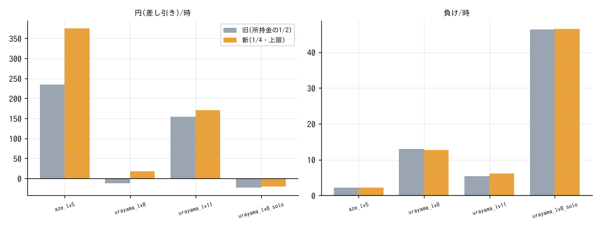

`node tools/sim/run.js penalty`。**こもれび町のぬしを倒したあと**の円で測りました(倒す前は負けても円は減りません)。新(所持金の1/4・上限 2000×(町の番号+1)円)と、旧(1/2)を、同じ種で比べました。各12時間。

| 場所 | 勝率 | 負け/時 | 円の増え(新) | 円の増え(旧) | 釣り合う所持金(新) | (旧) |
|---|---|---|---|---|---|---|
| あぜ道・3体 Lv5 | 98% | 2.2 | +375/時 | +235/時 | 約3,100円 | 約1,600円 |
| 裏山・3体 Lv8 | 83% | 12.7 | +18/時 | −12/時 | 約640円 | 約320円 |
| 裏山・3体 Lv11 | 93% | 6.1 | +170/時 | +155/時 | 約2,100円 | 約1,200円 |
| 裏山・相棒1体 Lv8 | 39% | 46.5 | −21/時 | −23/時 | 約60円 | 約30円 |

- 負けるたびに所持金が減るので、**勝率が低いと所持金は一定の値(釣り合う所持金)より増えません**。新ルールだと、旧の約2倍まで貯められます。
- 裏山 Lv8 の 640円は、ばんそうこう(30円)を20個、反魂香(2400円)には届かない水準で、「ちょっと怖い寄り道は、道具を買い込んで行く場所ではない」という位置づけと合います。反魂香(2400円)が買えるのは、Lv11 で勝率93%ほどになってからです。
- **調整はしませんでした**。1/4・上限つきの式は、DESIGN どおりで、目標の「道具の価格帯と釣り合う」を満たしています。上限(町の番号が上がるほど高くなる 2000×(番号+1)円)は、後半の収入(1時間で数万円以上)に比べて小さく、後半は負けの罰がほぼ効きません。これを締めるかどうかは、後半を測ってからの判断です(今回は序盤〜中盤の測定のみ)。

### 3-6. 流星石(ガチャ)の流入(DESIGN 5-2 の 9)

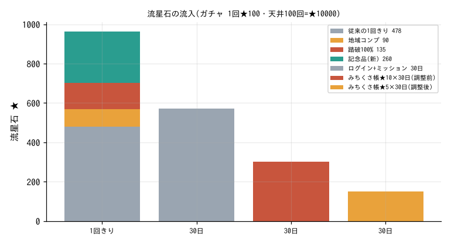

`node tools/sim/run.js stars`(数えるだけ)。ガチャは 1回★100、天井100回(★10000)。

| 入り口 | 量 |
|---|---|
| 従来の1回きり(ぬし・杯・依頼・図鑑の初取得・旧記念品) | 約★480(ぬし135+杯70+依頼100+初めて仲間にした種族148+旧記念品25) |
| 地域コンプ(9町×★10) | ★90 |
| 踏破100%(45マップ×★3) | ★135 |
| 図鑑の記念品(新: 60〜148種) | ★260(70種で20、100種で50、130種で100、ほか5ずつ) |
| **新しい1回きりの合計** | **★485**(従来の約1倍。ただし天井★10000 の5%、ガチャ約5回ぶん) |
| 1日: ログイン+ミッション | 約★19/日 |
| 1日: みちくさ帳 | 調整前 ★10/日(+53%) → **調整後 ★5/日(+26%)** |

- 1回きりの合計 ★485 は、ゲーム全体で ガチャ5回ぶんで、ガチャが安くなりすぎることはありません。
- 毎日入る ★10 は、1日のログイン+ミッション(★19)の5割増しで、1か月に★300(ガチャ3回)になります。みちくさ帳の点が毎日はたまらないので、実際の流入はこれ以下ですが、★5 に下げました。

---

## 4. メタル系(DESIGN 5-1 の 5)

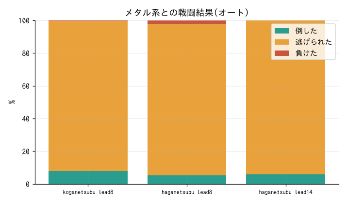
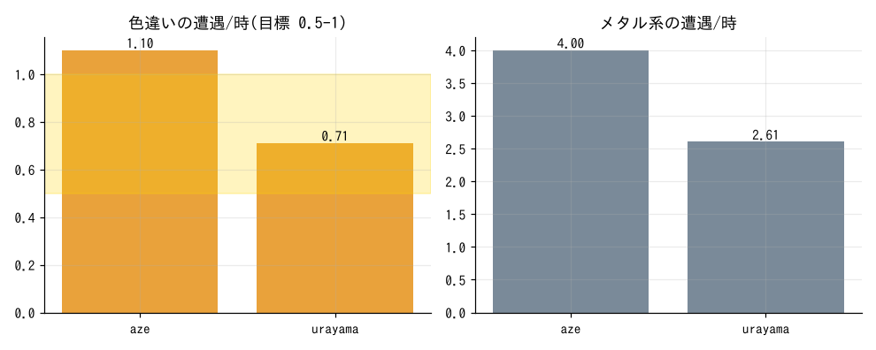

オートで400戦(先頭1体 Lv8、敵 Lv6)。

| 敵 | | 倒した | 逃げられた | 負けた |
|---|---|---|---|---|
| コガネツブ | 調整前 | 9% | 91% | 0% |
| | **調整後** | **27%** | 71% | 2% |
| ハガネツブ | 調整前 | 5% | 94% | 2% |
| | **調整後** | 8% | 73% | **19%** |
| ハガネツブ(先頭Lv14) | 調整前 → 調整後 | 5% → 13% | 95% → 83% | 0% → 5% |

- 調整前は、救済きらり(逃げたら30歩以内に出る)が入ったのに、1体倒すまでが**約6時間**(メタル系は1時間に約4体、倒せるのは3%)でした(改修前は約3.8時間)。
- 逃げる確率 35→15%、ふつうの攻撃が必ず1ダメージ(以前は半分の確率で0)にしたことで、倒す率がコガネツブで3倍になり、**約1.3時間に1体**(メタル系 約4体/時 × 平均倒す率 約20%)になりました。
- ハガネツブには、先頭1体だと19%で負けます。逃げなくなった分、ハガネツブが殴ってくるためです。3体ならだいぶ減ります。ここは調整の余地ですが、「逃がさないと痛い目にあう」としておきました。

## 5. スカウト・ほかの項目

スカウトの成功率(`scoutP`)は変えていないので、改修前の表のとおりです(あぜ道・先頭Lv3で、HP満タン 30%、半分 54%)。1時間あたりの経験値・円(ぬし前、あぜ道・3体・Lv5)は、調整前 4,003 経験値 / +1,681円 / 103戦 → 調整後 4,447 / +1,763 / 110戦(出現表の重みの変更の差の範囲)です(以前の「円」は負けて半分になる分を含んでいたので、改修前の数字より増えて見えます)。

---

## 6. 測り直しかた

```sh
node tools/sim/run.js <項目名> [--n 件数] [--seed 1]
python3 tools/sim/plot.py     # 既存のグラフ(調整後)
python3 tools/sim/plot2.py    # 新しい仕組みのグラフ(調整前=tools/sim/out_before と調整後=tools/sim/out を並べる)
SIM_GAME=path/to/game.html node tools/sim/run.js opening --out 別のフォルダ   # 別の版を測る
```

| 項目名 | 測るもの | 時間の目安 |
|---|---|---|
| `opening` | 最初の1戦(才能(8,12)固定も) | 26秒 |
| `sequence` | 連戦の勝率(1体/3体) | 95秒 |
| `field` | 裏山・あぜ道のLv別勝率(序盤補正は外して測る) | 105秒 |
| `income` | 1時間の経験値・円・遭遇(きらりを踏みに行く) | 25秒 |
| `shiny` / `scout` / `metal` | 色違い・メタルの遭遇、スカウト、メタル戦 | 数秒 |
| `boss` | ぬしのLv別勝率と、倒すまでの時間。**`--n 60` で約3分**(指定しないと10倍かかる) | 3分 |
| `wxfind` | 天候限定7体に出会うまで(狙う/狙わない) | 8秒 |
| `hoshiw` | ホシクズメの重みごとの会える回数 | 1秒 |
| `bonus` | 寄り道の段・きらり・色違い(通常/きらり/星降り) | 2.5分 |
| `points` | みちくさ点と、全マップを歩き切る時間 | 1秒 |
| `region` | 地域コンプの時間 | 1秒 |
| `penalty` | 負けの罰(新/旧)・円の増え | 2分 |
| `stars` | 流星石の流入(数えるだけ) | 1秒 |

`all` は上をすべて順に測ります(1項目ごとに新しいページで測る)。前提の値は `tools/sim/params.js`(1歩 0.185秒、回復の往復 40秒、負けたあとの寄り道の歩き直し 120秒、区画を回る歩数は最短の2倍、など)にあります。前提を変えたら `income`→`shiny` の順に測り直してください。

### シミュレータで直したこと

- 天気は実際の日付+町+時間帯で決まります(AUDIT 5 の対応後)。シミュレータは `Date.now` を `S.dayOff` 日ぶんずらし、ゲームごとに乱数の日付から始めて、時間帯が1周するたびに1日進めます(`wxN` は使いません)。
- 色違い・きらりの遭遇は `owBattleGo` の `setTimeout` で戦闘が始まるので、これを待たずに数えると、色違いの遭遇を取りこぼしていました。`S.settle` で待つようにしました。
- メタルに逃げられた戦闘は、勝ちでも負けでもないので、勝率に数えないようにしました。


---

## 追記: AUDIT 1・5・9 の対応後の再測定

### 踏破率の分母(AUDIT 1)

`footInfo` が数える区画を、床の文字だけでなく、建物(objs)・しかけ(流氷の通る道・岩を押し込める穴・トロッコとカヌーの線路でつながった乗り場・輪・間欠泉)を見た到達可能性で数えるようにしました。区画番号の付け方(4×4マス、左上から)は同じなので、セーブの `foot` ビットは読み替え不要です。全46マップ・2,731区画が、実際の通行判定(`owSolid`。潮・昼夜・流氷の全位置・霧の晴れ間・ぬしと旗は全部解けたものとして)で到達でき、踏み尽くすと100%・スタンプ2になります(`node tools/test/run.js` の T2 ソルバー)。

100%に届かなかったマップ(修正前は「到達できる区画を全部踏んだときの最大率」):

| マップ | 修正前の分母 | 修正前の最大 | 修正後の分母 | 修正後 |
|---|---|---|---|---|
| 霞ヶ丘 | 25 | 96% | 24 | 100% |
| 雑居ビルの路地裏 | 20 | 95% | 19 | 100% |
| 旧地下鉄のトンネル | 17 | 94% | 16 | 100% |
| 潮見 | 28 | 96% | 27 | 100% |
| 漁港 | 15 | 93% | 14 | 100% |
| 迷い家 | 37 | 97% | 36 | 100% |
| 大楠の迷い森 | 80 | 88% | 71 | 100% |
| 旧環状線 | 54 | 55% | 30 | 100% |
| 南波線(なんぱせん) | 154 | 40% | 63 | 100% |
| 龍氷 | 70 | 94% | 66 | 100% |
| 幻星林 | 179 | 99% | 178 | 100% |
| 氷海 | 272 | 59% | 162 | 100% |
| 地獄谷 | 153 | 90% | 138 | 100% |
| 珊瑚の町 | 42 | 97% | 41 | 100% |
| 白浜 | 192 | 62% | 120 | 100% |
| 昼木の森 | 58 | 56% | 33 | 100% |
| 黄泉 | 51 | 98% | 50 | 100% |
| 彼岸野 | 104 | 99% | 103 | 100% |
| 忘れ川 | 224 | 66% | 149 | 100% |
| 彼方 | 62 | 98% | 61 | 100% |

(上の表以外の26マップは、修正前も後も100%でした。分母の合計は 2,998 → 2,731 区画。)

みちくさ点(`points`、まぼろし駅を含む46マップ): 総点 **4,191点**(まぼろし駅 199点を含む。まぼろし駅を除く45マップは 3,992点、修正前は 4,428点)。全マップを歩き切る時間は 3.5時間(まぼろし駅 16分を含む)、1時間あたり約 1,190点。到達の目安: 300点 0.27時間、1,000点 0.77時間、2,500点 2.2時間、3,000点 2.5時間。
天賦の宝珠 3,000点は総点の **72%**、みちくさ名人 累計2,500点は **60%** で、DESIGN の「7〜8割」に収まっています。交換品の点は変えません。
(区画が減った分、総点は6%減りました。巡回シミュレータは輪・流氷・氷の滑りを歩いて数えるので、氷海・黒曜(こくさ)・溶岩洞などの「歩いて行けない区画」の数え漏れは上と同じ程度残ります。実際のプレイの到達は T2 のテストが保証します。)

### 天気(AUDIT 5)

天気は `実際の日付 + 町 + state.time` だけで決まります。ベンチで休んでも(時間が1周しても)同じ日・同じ時間帯の天気は変わりません。みちくさ便りの予報(`wxOf`)も同じ規則です。1日は時間帯ごとの4つの天気で、「雨の日に来る」理由になります。

7日(星降りは夜だけなので14日)の窓で、各町・各天気が1度も出ない確率を、2,000日ぶんの窓で測りました。調整前は、霞ヶ丘の霧 28.5%、天狗の雪 27.4%、珊瑚の霧 23.9%、こもれびの霧 6.9%、龍氷の霧 6.1%、黄泉の晴れ 6.0%、星降り(14日)は最大 12%超でした。`WX_TBL` の重みを、どの天気も 12 以上・星降りを 32 以上にして、**最大 4.9%**(14日の星降り。昼の天気は最大 4.3%)に下げました(テスト `T1: 天気の偏り`)。

`wxfind`(天候限定7体に出会うまで、狙う/狙わない、中央値の分):

| 種(町) | 狙う 前→後 | 狙わない 平均 前→後 |
|---|---|---|
| アマヤドリ(こもれび) | 7.3 → 7.4 | 29.3 → 34.4 |
| キリガラス(天狗) | 5.2 → 5.4 | 21.2 → 33.2 |
| ニジミミズ(霞ヶ丘) | 6.4 → 7.2 | 31.8 → 31.6 |
| ユキワタ(龍氷) | 8.0 → 7.4 | 19.4 → 21.8 |
| ハイカグラ(日ノ島) | 4.3 → 4.2 | 15.7 → 18.7 |
| クモズミ(潮見) | 4.3 → 4.4 | 40.4 → 32.8 |
| ホシクズメ(こもれび) | 12.4 → 9.9 | 120 → 121 |
| ホシクズメ(天狗) | 8.2 → 5.9 | 115 → 89 |
| ホシクズメ(黄泉) | 4.7 → 5.4 | 50 → 63 |

「狙う」は予報を見るので、ほぼ変わりません。「狙わない」の平均は、日をまたぐ偏りが入る分だけゆれています(100回の測定の誤差の範囲)。星降りの重みを上げたので、ホシクズメ(天狗)は出会いやすくなりました。

### まぼろし駅(AUDIT 9)

入口は「霧 × 夜 × 霞ヶ丘のぬし撃破」のままです。霧の出る確率を上げたので(霞ヶ丘・珊瑚の町の霧 5% → 12%)、1週間のうちに霧の夜が来ない町が減りました(上の 28.5% / 23.9% → 4.3% / 0%)。みちくさ点は上の 199点(169区画)で、点の計算に入れています。路線図と駅の札は、初めて着くまで「？？駅へ行く」、着いたあとは「まぼろし駅へ行く」です。
