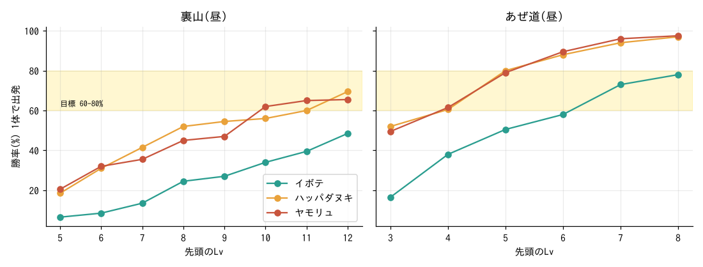
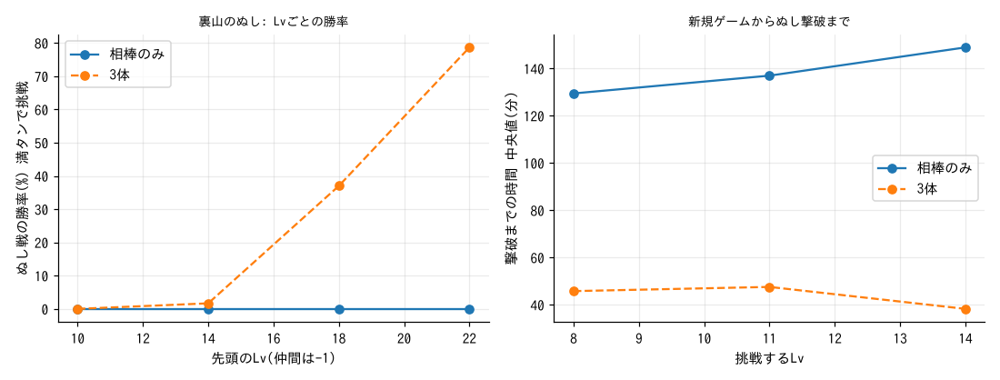
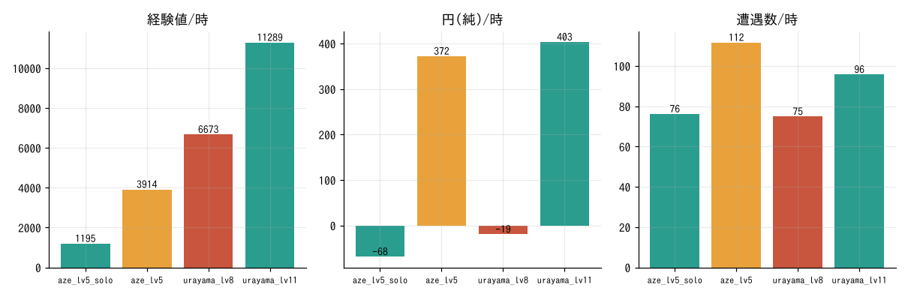
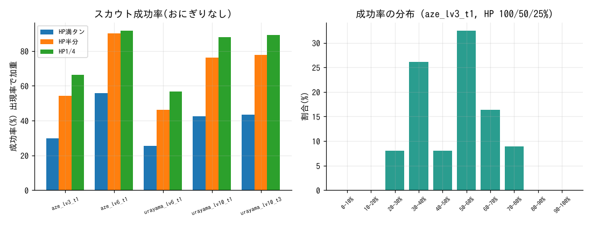

# BALANCE: 改修前の基準値

作成: バランス解析班(balancer) 2026-11-18

> **この数値は「改修前の基準値」です。**
> 測ったのは古い main(コミット `a4df3ae`)の `src/game.html` です。T1 天気・T2 寄り道ボーナス・T3 きらり・T6 序盤補正は、まだ入っていません。
> 統合版ができたら、同じスクリプトでもう一度測ります(下の「測り直しかた」)。そのときは、この表に「改修後」の列を足して比べます。

測りかた: Playwright でゲームを開き、ゲーム本物の関数(`H.starter` `newMon` `owArrive` `owEncounter` `startBattle` `autoTurn`/`runTurn` `win` `lose` `scoutP` `H.boss`)をそのまま動かして、モンテカルロで数えました。ゲームのソースは書き換えていません。画面の描画・保存・効果音は空にし、戦闘の待ち時間は0秒で進めて、その秒数だけを数えています。乱数は種(seed=1)で固定しているので、同じ版なら同じ結果になります。

## 0. 先に知っておくこと(DESIGN.md の数字とのちがい)

- **出現Lvは、DESIGN.md に書いた値より高い。** `TOWNS` の Lv は、あとで `OW_LV(…,1.25)` によって上げられています(game.html 2623 行)。実際に出る値は次のとおりです。
  - あぜ道: Lv **2〜5**(表では 1〜4)、最大2体
  - 裏山: Lv **5〜10**(表では 4〜8)、最大3体
  - 裏山のぬし ツキノワ: Lv **12**(表では 10)。さらに HP×1.6、攻撃×0.9
- 相棒の才能は、いまは `randTalent(5,12)` です。DESIGN 5-3 の条件 `(8,12)` でも別に測りました。
- **イボテには、Lv1 で攻撃技がありません。** 覚えているのは「まぼろしほうし」(全体を混乱させる技)だけです。このため、3体の中でイボテだけが極端に弱くなっています。
- オート戦闘の AI は、味方も `ai()` を使います。手で操作するより少し弱めの結果になります。

### 時間換算の前提(`tools/sim/params.js`)

| 値 | 意味 | 根拠 |
|---|---|---|
| 0.185 秒/歩 | ふつうに歩いたときの1歩 | `owLoop` の移動量 .09/フレーム ÷ 60fps |
| 戦闘の秒数 | `wait()` で待つ合計(ふつうの速さ)＋1ターンごとに0.35秒＋2.4秒 | `runTurn`・`BSPD`。2.4秒は頭出しと結果を閉じる時間(仮) |
| 40 秒/回 | 回復しに戻って、また来るまで | 仮の値 |
| HP 45% 未満 | 戦闘のあと、これより減っていたら回復に戻る | プレイヤーの動きの仮定 |
| 草むら 100% | 歩数がすべて草むら(草むらを行ったり来たりする) | 上限の見積もり。実際のプレイでは、もっと少なくなります |

---

## 1. 結果の一覧

| # | 項目 | 目標(DESIGN.md) | 現状値(改修前) | 判定 |
|---|---|---|---|---|
| 11a | 最初の草むら・最初の1戦の勝率(オート) | 95% 以上 | イボテ **20%** / ハッパダヌキ **45%** / ヤモリュ **48%** | ✕ |
| 11a' | 同じ。才能を (8,12) に固定 | 95% 以上 | 18% / 50% / 52% | ✕(才能だけでは、ほぼ変わらない) |
| 11b | 4戦目以降の勝率(相棒1体のまま) | 85% 以上 | 26% / 59% / 60% | ✕ |
| 11b' | 4戦目以降の勝率(仲間を2体スカウトした3体) | 85% 以上 | 96% / 99% / 99% | ○ |
| 12 | 裏山の勝率 | 60〜80% | 3体・Lv5〜7 で **56〜84%**(目標の範囲内)。相棒1体・Lv8 では 24〜52% | 3体なら○ |
| 13 | こもれび町のぬしを倒すまで | 早くなりすぎない | 3体: 中央値 **38〜48分・73〜88戦**。挑戦は平均4〜6回、倒したときのLvは約19。相棒1体: 6時間で倒せたのは17%だけ | 難しすぎる |
| 7 | 1時間あたりの経験値・円(寄り道ボーナスなし) | 寄り道は1.3〜1.5倍(T2 が入ってから) | あぜ道(3体・Lv5): **経験値3,900・+370円・112戦**。裏山(3体・Lv8): 経験値6,700・**−20円**・75戦 | 基準値 |
| 4 | 色違いと出会う回数/時 | 0.5〜1 回 | 草むらで戦い続けた場合: あぜ道 **1.10**、裏山 **0.71** | 上限の見積もりでは、目標の範囲内か少し上 |
| 5 | メタル系の遭遇率・逃げる率 | (救済きらりで短くする) | 遭遇の **3.5%**(4.0回/時)。逃げられる **92〜94%**、倒せる **5〜8%**。1体倒すまで約 **3.8時間** | 長すぎる |
| — | スカウトの成功率(あぜ道・Lv3) | — | HP満タンで30%、半分で54%、1/4で66%。おにぎりを使うと 48/87/91% | 基準値 |

---

## 2. 序盤の勝率(DESIGN 5-3 の 11)


`node tools/sim/run.js opening`。新しくゲームを始めて `H.starter` で相棒を選び、あぜ道で `owEncounter('aze')` を呼んでオートで戦います。各相棒1000戦。棒の上の細い線は95%信頼区間、◆は才能を (8,12) に固定した場合です。

| 相棒 | 勝率 | 敵1体のとき | 敵2体のとき | 才能(8,12) |
|---|---|---|---|---|
| イボテ | 19.7% (17.4–22.3) | 32% (197/607) | **0%** (0/393) | 17.8% |
| ハッパダヌキ | 44.7% (41.6–47.8) | 71% | 10% | 50.1% |
| ヤモリュ | 48.2% (45.1–51.3) | 73% | 12% | 51.7% |


- 負けのほとんどは **敵が2体のとき**(あぜ道の4割)と、**Lv4〜5の敵**です。才能を上げても、ほぼ変わりません(イボテは誤差の範囲で下がりました)。
- **調整案**
  1. T6 の「3勝するまでは1体だけ、Lv は min(抽選, 先頭Lv−1)」が、この不足をほぼ埋める本命です。敵1体・Lv2 の条件で測り直すと、95%を超えるかがわかります(統合版で `opening` を測り直す)。
  2. **イボテに Lv1 の攻撃技を足す**(例: `kamitsuki` 相当)。または、イボテの敵だけ補正を強くする。いまは攻撃が通常攻撃しかないので、T6 の補正が入っても、3体の中でいちばん下に残るはずです。
  3. 才能 (5,12)→(8,12) は、入れてもかまいません。ただし、勝率への効果はほぼありません。

### 続けて戦ったとき(4戦目以降)


`node tools/sim/run.js sequence`。草むらを歩いて(本物の `owArrive` の抽選)12戦します。各相棒300ゲームです。HP が45%を切ったら全回復し、負けたら `lose()` で家に戻されます。比べたのは2つの場合です。「相棒1体のまま」と、「あぜ道の魔生物を2体スカウトしたことにした3体(才能は野生と同じ0〜10)」です。

| 何勝したあとか | 1体: イボテ / ハッパ / ヤモリュ | 3体: イボテ / ハッパ / ヤモリュ |
|---|---|---|
| 0勝 | 22% / 48% / 48% | 80% / 93% / 92% |
| 1勝 | 20% / 44% / 43% | 83% / 90% / 94% |
| 2勝 | 19% / 45% / 49% | 87% / 94% / 95% |
| **3勝以上** | **26% / 59% / 60%** | **96% / 99% / 99%** |

- 相棒1体のままだと、何戦しても Lv が上がりません(負けると経験値が入らないため)。12戦目でも、Lv は3.1(イボテ)〜3.9 にとどまります。
- **調整案**: 4戦目以降の 85% は、**仲間が増えるかどうかで決まります**。T6 の補正を外したあと、スカウトしていない人がまた負け続けないように、次の2つを入れます。
  - 「パーティが1体のあいだは、敵は1体だけ」という条件を、3勝の補正とは別に残す。
  - 最初の3勝のあいだに、スカウトの案内を出す(おにぎりを2個持っているので、おにぎりを使えば HP 半分で87%成功します)。

---

## 3. 裏山(DESIGN 5-3 の 12)




`node tools/sim/run.js field`。先頭の Lv を決めて、HP 満タンから1戦だけ戦います。各点200戦で、3体の平均です(3体のときの仲間は、先頭のLv−1)。

| 先頭Lv | 1体・昼 | 1体・夜 | 3体・昼 |
|---|---|---|---|
| 5 | 15% | 14% | 61% |
| 6 | 24% | 22% | 68% |
| 7 | 30% | 28% | 80% |
| 8 | 40% | 36% | 86% |
| 10 | 51% | 53% | 93% |
| 12 | 61% | 62% | 98% |

- 3体で Lv5〜7 なら、目標の **60〜80%**(「ちょっと怖い寄り道」)に入っています。Lv9 を超えると、ほぼ負けません。
- 夜と昼の差は、ほとんどありません(夜は−0〜4ポイント)。いまの夜の敵(ホタルビ・ハカモリ・ヨタカゲ)は、夜を怖くしていません。
- **調整案**: 裏山の Lv と数は、いまのままで目標どおりです。T6 で序盤をやさしくしても、裏山には補正をかけないでください。夜を手ごわくしたいなら、夜だけ `max:3` の重みを上げるか、夜の敵の Lv を+1 にします。T1 で天気の補正を入れたら、このグラフを天気ごとに測り直します。

---

## 4. こもれび町のぬしまで(DESIGN 5-3 の 13)



`node tools/sim/run.js boss`。

- 左のグラフ: HP 満タンでぬしに挑んだときの勝率です(各100戦×3体)。**相棒1体では Lv22 でも0%**でした。3体では Lv14 で2%、Lv18 で37%、Lv22 で79%です。
- 右のグラフ: 新しくゲームを始めてから倒すまでの時間です。草むらで戦い、先頭が Lv6 になったら裏山へ移ります。決めた Lv に届いたらぬしに挑み、負けたら Lv を2つ上げてからまた挑みます。各18ゲームです。
  - 3体: 中央値 **38〜48分・73〜88戦**。挑戦は平均4〜6回で、倒せたときの Lv は平均19です。どの Lv で初めて挑んでも、1回目は全員負けました。
  - 1体: 6時間・800戦のうちに倒せたのは17%だけでした(右のグラフの青い線は、倒せた人だけの時間です)。
- **調整案**: ぬしの Lv12 は、Lv を上げる補正(×1.2)で決まっています。これに HP×1.6 が重なっていて、**序盤のぬしとしては重すぎます**。目安は「3体・Lv12で勝率60%前後、30分前後で倒せる」くらいです。候補は次の2つです。
  - `startBattle` のぬしの HP 倍率を、こもれび町だけ 1.6→1.2 にする。
  - ぬしの Lv を `OW_LV` の補正の外に出して、10 に戻す。
  
  どちらを選ぶかは、統合版で `boss` を測り直して決めます。T6 で序盤が楽になると、ぬしの前で詰まる感じがかえって強くなるので、いっしょに直すのがおすすめです。

---

## 5. 1時間あたりの経験値・円(DESIGN 5-2 の 7・10)



`node tools/sim/run.js income`。各相棒で4時間(仮想の時間)、合計12時間です。経験値は敵で決まるので、測っているあいだ味方の Lv は固定しました。

| 場所 | 経験値/時 | 円(差し引き)/時 | 戦闘/時 | 勝率 | 1戦の秒数 |
|---|---|---|---|---|---|
| あぜ道・相棒1体 Lv5 | 1,195 | **−68** | 76 | 60% | 22.3 |
| あぜ道・3体 Lv5 | 3,914 | +372 | 112 | 98% | 17.2 |
| 裏山・3体 Lv8 | 6,673 | **−19** | 75 | 80% | 22.3 |
| 裏山・3体 Lv11 | 11,289 | +403 | 96 | 93% | 18.8 |

- 1回負けると所持金が半分になります。そのため、**勝率が9割を切ると、円は差し引きでマイナスになります**。裏山 Lv8 は、経験値はあぜ道の1.7倍ですが、円は減ります。
- **調整案(T2・T6 との関係)**
  - 寄り道ボーナス(T2)の「1.3〜1.5倍」は、上の **あぜ道・3体 Lv5(経験値3,900/時)** を基準に比べます。ただし裏山は、いまでも経験値が1.7倍です。ボーナスが +50% だと、2倍を超えるおそれがあります(目標は2倍を超えないこと)。T2 が入ったら、同じ設定で測って確かめます。
  - 負けの罰を 1/4・上限つき(T6)にすると、裏山 Lv8 の円はプラスに変わるはずです。ばんそうこう(30円)なら1時間に10個以上、反魂香(2400円)なら6時間に1個、くらいのたまり方になる見込みです。

---

## 6. 色違いとメタル系(DESIGN 5-1 の 4・5)


`node tools/sim/run.js shiny`。戦わずに遭遇だけを、昼と夜で4万回ずつ数えました。1時間あたりの回数は、`income` で測った1時間の戦闘数(3体)から換算しています。

| | あぜ道 | 裏山 |
|---|---|---|
| 遭遇までの歩数 | 9.2 歩(率 0.109) | 9.1 歩 |
| 色違いの率(敵1体ごと) | 1/141 | 1/157 |
| 色違いが入っている戦闘の率 | 1/101 | 1/105 |
| **色違い/時**(草むらで戦い続けた場合) | **1.10** | **0.71** |
| メタル系が入っている戦闘の率 | 3.6% | 3.5% |
| メタル系/時 | 4.0 | 2.6 |

- DESIGN.md では「いまは0.2回前後」と見ていました。実際には、**草むらで戦い続ければ、もう1時間に0.7〜1.1回**出会えます。0.2回くらいになるのは、時間の7〜8割を移動・会話・配合などに使う、ふつうのプレイのときです。
- きらり(T3、1/30)を入れると、草むらで戦い続けた場合は1時間に2回を超えるおそれがあります。**「色違い/時」は、遊んだ時間全体で測るのか、草むらで戦っている時間だけで測るのかを先に決めてください**。いまのスクリプトは後者(上限の見積もり)です。前者は `params.js` の `GRASS` で近い値を出せます。


`node tools/sim/run.js metal`。オートで400戦しました。

| 敵 | 先頭Lv | 倒した | 逃げられた | 負けた |
|---|---|---|---|---|
| コガネツブ | 8 | 7.8% | 91.8% | 0.5% |
| ハガネツブ | 8 | 5.3% | 92.5% | 2.3% |
| ハガネツブ | 14 | 5.8% | 94.3% | 0% |

- メタル系は、行動するたびに35%で逃げます。ダメージは0か1しか通りません。このため、**Lv を上げても倒せる率はほぼ変わりません**。あぜ道でメタル系を1体倒すまでに、1/(4.0×0.065) で **約3.8時間**かかります。
- **調整案**: 救済きらり(T3)では、逃げる率 35%→20%、または会心の率を上げることで、「1体倒すまで1時間前後」を目安にします。さびおとし(必ず2〜4ダメージ)を序盤で手に入れられるようにするのも効きます。

---

## 7. スカウトの成功率



`node tools/sim/run.js scout`。本物の `scoutP` を、出現表の重みで平均しました。右のグラフは、あぜ道・Lv3 で、HP 100/50/25% の敵に1回スカウトしたときの成功率の分布です。

| 条件 | HP満タン | HP半分 | HP1/4 | おにぎり(満タン/半分/1/4) |
|---|---|---|---|---|
| あぜ道・先頭Lv3 | 30% | 54% | 66% | 48 / 87 / 91% |
| あぜ道・先頭Lv6 | 56% | 90% | 92% | 88 / 92 / 92% |
| 裏山・先頭Lv6 | 26% | 46% | 57% | 41 / 74 / 87% |
| 裏山・先頭Lv10(昼) | 43% | 76% | 88% | 68 / 91 / 92% |

- 成功率は、敵の HP 割合と、味方と敵の Lv の比(0.6〜1.4)で大きく変わります。序盤は「弱らせてからスカウト」で、5割以上になります。
- **調整案**: スカウトの数字は、いまのままでかまいません。上に書いたとおり、序盤の勝率は「仲間がいるか」で決まります。最初の3勝のあいだにスカウトしてもらえるよう、案内を厚くする方が効きます。

---

## 8. 測り直しかた

```sh
node tools/sim/run.js <項目名> [--n 件数] [--seed 1]
python3 tools/sim/plot.py          # tools/sim/out/*.json → docs/update/balance/*.png
```

| 項目名 | 測るもの | 既定の件数 | かかる時間(目安) |
|---|---|---|---|
| `opening` | 最初の1戦の勝率(相棒3体×1000戦、才能(8,12)固定の場合も) | `--n 1000` | 15秒 |
| `sequence` | 12戦続けたときの、何勝目ごとの勝率(1体/3体) | `--n` の1/10ゲーム(既定300) | 1.5分 |
| `field` | 裏山・あぜ道の、Lvごとの勝率(昼/夜/3体) | `--n 200`/点 | 2分 |
| `income` | 1時間あたりの経験値・円・戦闘数 | 4時間×3体 | 20秒 |
| `shiny` | 色違い・メタル系の遭遇率と1時間あたりの回数(先に `income` を測っておく) | 4万遭遇×昼夜 | 1秒 |
| `scout` | `scoutP` の表 | — | 1秒 |
| `metal` | メタル系との戦闘結果 | `--n 400` | 5秒 |
| `boss` | ぬしの Lvごとの勝率と、ぬしを倒すまでの時間(`--thr 8,11,14`) | `--n` の1/10ゲーム(既定60) | 3分 |
| `all` | 上をすべて、この順で | | 約8分 |

- 測るゲームを変えるには `SIM_GAME=path/to/game.html node tools/sim/run.js opening` とします(既定は `src/game.html`)。
- 統合版(T6 入り)では、**何も変えずに**同じコマンドで測れます。`H.starter`(才能の範囲)、`owEncounter`(3勝までの補正)、`win`(`state.wins`)、`lose`(負けの罰)は、すべてゲームのものを呼んでいるので、改修した中身がそのまま反映されます。
- T1(天気)が入ったら、`page.js` の `S.encounters` で `state.weather` を固定するひと行を足すだけで、天気ごとの出現割合を測れます。T3(きらり)の前兆が `owArrive` の中で抽選されるなら、`walkToEncounter` で数えるだけです。
- 時間換算の前提は `tools/sim/params.js` にまとめてあります。前提を変えたら、`income`→`shiny` の順に測り直してください。
- 結果の JSON は `tools/sim/out/` にあり、使った前提値(params)と seed もいっしょに入っています。

### しくみ(`tools/sim/page.js`)

- `render` `save` `talk` `sfx` `cutIn` `bshake` は、何もしない関数に差し替えています。
- `setTimeout` は、すぐに実行するように差し替えています。そのうち `wait()` が使う Promise の待ち時間だけを、戦闘の秒数として足しています。
- `B.auto=true` にして `autoTurn()` を呼ぶと、戦闘は最後まで進みます。
- 遭遇は、草むらのマスで本物の `owArrive()` を1歩ずつ呼んで起こしています。120歩ごとの時間の進み・遭遇率・`lvUp` も、ゲームのとおりです。
- `Math.random` は種つきの mulberry32 に差し替えています。
