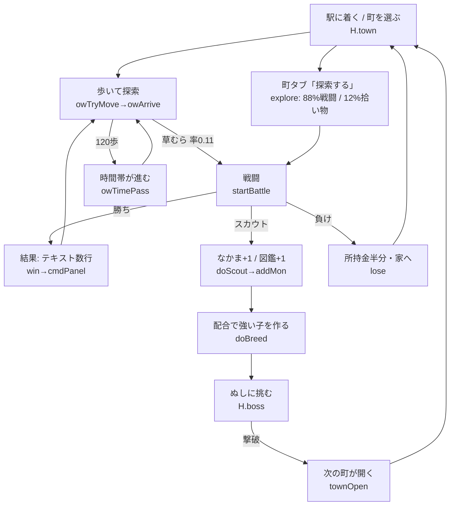

# DESIGN（大型アップデートのゲームデザイン）

作成: 企画参謀（game-designer） 2026-11-18
入力: [RECON.md](RECON.md) / [recon_systems.md](recon_systems.md) / [recon_play.md](recon_play.md) / [recon_assets.md](recon_assets.md) / `before/*.png` / `src/game.html`（行番号は調査時点のもの。編集で前後するので、**関数名で探すこと**）

テーマの一言: **「本筋から外れた分だけ、世界が応えてくれる」**。
いまのミチクサ鉄道は「しかけの多いマップ」と「豊富な魔生物」を持っているのに、寄り道しても **数字も演出も返ってこない**。今回は、寄り道に対して「天気」「前兆」「足あと」「図鑑」「隠し駅」の5つの返事を用意する。

---

## 1. 現状のコアループと、退屈・報酬不足・やめどき

### 1-1. コアループ（現状）

外側のループ: **町に着く → 歩く/戦う → スカウト → 配合 → ぬし → 次の町**。
内側のループ: **歩く → 草むらで抽選 → 戦闘 → 結果 → 歩く**。
寄り道（裏山・路地裏・磯・洞窟・吊り橋…）は外側ループの「ぬし」の前に置かれた **通路** でしかなく、そこに居続ける理由・戻る理由がない。

### 1-2. 退屈な瞬間（根拠つき）

| # | 瞬間 | 根拠（コード / 画面） |
|---|---|---|
| D1 | 歩いても何も起きない。抽選は「草むらタイルかどうか × 0.11」だけで、景色が変わるのは120歩に1回 | `owArrive`（5225-5244）: `rate=(m.rate||.11)`、`if(state.owSteps>=120)…owTimePass()` |
| D2 | 町タブの「探索する」は判断なしの戦闘ボタン | `explore`（6726-6745）: `Math.random()<.12` 以外は必ず `startBattle` |
| D3 | 戦闘が長い・ボタンが多い。主コマンドが分からない | `cmdPanel`（6704-6721）: 同格のボタン最大11個。`before/08_battle_command.png` |
| D4 | 会話をスキップできない | `H.dlgNext`（6820）: 1行ずつ `d.i++` のみ |
| D5 | マップが画面の半分で、上下が黒い | `owResize`（5522-5530）: `rows=Math.min(rows,m.rows.length)`。こもれび町は約15×16マスなので縦が足りず余白に。`before/05_map_komorebi_day.png` |
| D6 | 時間帯の変化が小さなトーストだけ | `owTimePass`（5276-5285）: `ui.toast=t` のみ |

### 1-3. 報酬が薄い瞬間（根拠つき）

| # | 瞬間 | 根拠 |
|---|---|---|
| R1 | 勝利画面が文字だけ。経験値・円・レベルアップが同じ大きさの `
` で並ぶ | `win`（6617-6665）は `lines.push` の文字列だけ。`cmdPanel` の `B.phase==='end'`（6705-6708）。`before/16_battle_win_panel.png` |
| R2 | メタル系のレアに出会っても、逃げられると「勝利！ 魔生物は逃げてしまった……」 | `win` 6627 `B.enemies.some(c=>c.fled)`、タイトルは `r.win?'勝利！'`（6706）。`before/16` |
| R3 | 色違いに前兆も演出もない。見た目は hue-rotate だけ | `startBattle` 6340（1/150、能力+1のみ）、CSS 81 `.seal img.spr.shiny{filter:hue-rotate(150deg)…}` |
| R4 | はじめての種族をなかまにしても★1だけ | `firstOwn`（2238） |
| R5 | 図鑑の記念品が51種で終わる（全141種） | `DEX_MS`（1453）: 10/20/30/40/51 |
| R6 | 図鑑が系統別だけで、「この町はあと何体」が分からない | `renderDex`（6282-）の `famProg`・`groups` は `FK`（系統）で分けている |
| R7 | 寄り道の先の報酬が、見えている落とし物1回きり | `m.items` と `state.owItems`（4912 で描画、5385 で取得）。取ったら二度と何もない |

### 1-4. やめどき（離脱しやすい点）

| # | やめどき | 根拠 |
|---|---|---|
| Q1 | **最初の草むらで負ける** → 所持金半分 → 家に戻される | `H.starter`（6748）は Lv3・才能 `randTalent(5,12)`、あぜ道は `lv:[1,4],max:2`（1378）。`lose`（6667-6673）: `lost=Math.floor(state.yen/2)`。recon_play で実際に負けた |
| Q2 | ぬしを倒して次の町へ行くと、前の町に戻る理由がない | 町ごとの収集目標がない（R6）。夜・昼限定は町タブの小さな `<i>夜</i>` 表示だけ（`renderMap` 5817） |
| Q3 | デイリーが3項目だけで、毎日開く理由が弱い | `MISSIONS`（2241）: 歩数300・5勝・配合1 |
| Q4 | 図鑑が「？」だらけで、どこへ行けば埋まるか分からない | `renderDex` 詳細の `HAB` は見た種族しか出ない。`before/23_dex.png` |

---

## 2. 改善案（15案）

テーマ「みちくさ」で、**既存のマップのしかけ（信号・潮・釣り・溶岩・トロッコ・吹雪・流氷・突風・鏡・霧・キノコの輪・ゴミ箱）をそのまま“寄り道の目的地”に変える** ことを軸にする。

| ID | 案 | 要旨 | 主に効く課題 |
|---|---|---|---|
| P1 | **空もよう（天候）＋天候限定の魔生物** | 町ごとに天気（晴・くもり・雨・霧・雪・灰・星降り）が時間帯ごとに変わる。天気で出現表と画面が変わり、天気限定の新種が出る | D1 D6 Q2 Q3 |
| P2 | **みちくさ踏破（足あと）＋みちくさ帳** | 歩いたマスを記録し、マップごとの踏破率・スタンプ・「みちくさ点」を出す。本筋から外れた分だけ戦闘報酬が上がる「寄り道ボーナス」 | D1 R7 Q2 |
| P3 | **きらり（レア遭遇の前兆）＋色違いの演出強化** | 草むらに光る「きらり」が出て、踏むとレア確定。色違いは前兆・登場演出・専用配色 | R2 R3 D1 |
| P4 | **地域図鑑＋地域コンプ報酬＋記念品の拡張** | 町ごとの図鑑と達成報酬、141種まで記念品、出会った場所の記録（足あと） | R4 R5 R6 Q2 Q4 |
| P5 | **戦闘UIの主従整理＋結果画面の報酬演出** | 主コマンド4つを大きく、補助は小さく。敵HPの表示。勝利画面を「経験値バー・円のカウントアップ・新登録カード」に | D3 R1 R2 |
| P6 | **序盤の安心設計（難易度・負けの罰・会話スキップ）** | 最初の数戦は1体・低Lv、負けの罰を軽く、会話スキップ | Q1 D4 |
| P7 | **マップの大画面化＋時間帯・天気の告知演出** | 小さいマップでも拡大して画面を埋める。時間・天気の変化を駅サイン調の帯で知らせる | D5 D6 |
| P8 | **まぼろし駅（霧の夜だけ停まる隠し駅）** | 霧×夜のときだけ路線図に「？？」駅が出て、隠しマップへ行ける | Q2 Q3 R7 |
| P9 | しかけスタンプ | しかけ（釣り・トロッコ・鏡・流氷…）を初めて使うとスタンプ＋点。※P2 に統合 | R7 |
| P10 | 町タブ「探索する」に分かれ道 | 押すと「草むら／小道／物陰」の3択カード（戦闘・拾い物・レア前兆の割合が違う） | D2 |
| P11 | みちくさ便り（駅の天気予報とうわさ） | 駅で今日の天気予報と「雨の夜、裏山に○○が出るらしい」。※P1 に統合 | Q3 Q4 |
| P12 | デイリーの拡張（日替わり寄り道課題） | 「霞ヶ丘で雨の日に3勝」「新しいマスを40歩く」など、日替わり3枠 | Q3 |
| P13 | 車窓イベント | 電車移動のときに短いイベント（車窓に魔生物、落とし物、各駅停車で途中下車） | D1 |
| P14 | 音量スライダー・タブ名の切れ修正 | ON/OFF のみの音、「しくみ」が切れる問題 | 細かいUX |
| P15 | 一般の進化（Lv進化） | 四神以外にも進化を導入 | 長期目標 |

### 2-1. インパクト × 実装コスト

インパクト: 5=遊びの手ざわりが変わる、1=小さな改善。コスト: 5=大工事、1=数十行。優先度スコア = インパクト×2 − コスト（同点は「みちくさ」との一致度で決める）。

| ID | 案 | インパクト | コスト | スコア | 判定 |
|---|---|:-:|:-:|:-:|---|
| P1 | 空もよう＋天候限定魔生物（P11 込み） | 5 | 4 | 6 | **Top** |
| P2 | みちくさ踏破＋みちくさ帳（P9 込み） | 5 | 3 | 7 | **Top** |
| P3 | きらり＋色違い演出 | 5 | 3 | 7 | **Top** |
| P4 | 地域図鑑＋コンプ報酬 | 4 | 2 | 6 | **Top** |
| P5 | 戦闘UI整理＋結果演出 | 4 | 3 | 5 | **Top** |
| P6 | 序盤の安心設計＋会話スキップ | 4 | 1 | 7 | **Top** |
| P7 | マップ大画面化＋告知演出 | 4 | 2 | 6 | **Top** |
| P8 | まぼろし駅 | 5 | 4 | 6 | **Top**（大きく・おもしろい方を選ぶ） |
| P10 | 探索の分かれ道 | 3 | 2 | 4 | 次点 |
| P12 | デイリー拡張 | 3 | 2 | 4 | 次点（P1・P2 のあとなら安い） |
| P13 | 車窓イベント | 3 | 3 | 3 | 見送り |
| P14 | 音量・タブ名 | 2 | 1 | 3 | ついでに（ui-fx / sound-lab の余力で） |
| P15 | 一般の進化 | 4 | 5 | 3 | 見送り（配合が主役なので、競合する） |

### 2-2. 今回やる Top 8（確定）

| 順 | 施策 | 主担当 | 協力 |
|:-:|---|---|---|
| T1 | 空もよう（天候）＋天候限定の魔生物＋みちくさ便り | engineer | monster-forge, ui-fx, sound-lab, balancer |
| T2 | みちくさ踏破（足あと）＋みちくさ帳＋寄り道ボーナス | engineer | ui-fx, balancer |
| T3 | きらり（レアの前兆）＋色違いの演出・配色 | engineer | ui-fx, monster-forge, sound-lab |
| T4 | 地域図鑑＋地域コンプ報酬＋記念品の拡張 | engineer | ui-fx, balancer |
| T5 | 戦闘UIの主従整理＋結果画面の報酬演出 | ui-fx | engineer, sound-lab |
| T6 | 序盤の安心設計（難易度・負けの罰・会話スキップ） | engineer | balancer |
| T7 | マップの大画面化＋時間帯・天気の告知 | ui-fx | engineer |
| T8 | まぼろし駅（霧の夜だけの隠し駅・60×50 の隠しマップ） | engineer | monster-forge, ui-fx, sound-lab, balancer |

実装順の推奨: **T6 → T7 → T5 → T1 → T3 → T2 → T4 → T8**（T1 の天気判定を T3・T8 が使い、T2 の点を T4 が使うため）。

---

## 3. Top 施策の仕様

### 共通: セーブ互換のルール

- `state.v=1` は **変えない**。`load()`（5557）・`readCode()`（5746）・クラウドの `v` 判定はさわらない。
- 新しいキーはすべて **`migrate()`（6885）の既定値 `d` に追加**して、無ければ補う。`fresh()`（5555）にも同じ既定値を入れる。
- 新しいキーの一覧（このドキュメントで追加するもの全部）:

| キー | 型・既定 | 施策 | 中身 |
|---|---|---|---|
| `wxN` | 数 `0` | T1 | 時間帯が進んだ回数（天気の抽選の種） |
| `wxLog` | `{}` | T1 | `{天気id:true}` 体験した天気（便りと実績用） |
| `foot` | `{}` | T2 | `{mapId: 16進文字列}` 4×4マスの区画ごとの踏破ビット |
| `mpt` | 数 `0` | T2 | みちくさ点（使える残高） |
| `mptAll` | 数 `0` | T2 | みちくさ点の累計（称号・段位用。減らない） |
| `stamps` | `{}` | T2 | `{mapId:1(踏破80%)|2(100%)}`、`{'g:'+しかけid:1}` |
| `detour` | 数 `0` | T2 | 寄り道ボーナスの段（駅に戻ると0） |
| `kirari` | `null` | T3 | `{map,x,y,ttl}` 出ているきらり（1つまで） |
| `dexReg` | `{}` | T4 | `{townId:true}` 地域コンプ報酬を受け取った |
| `seenAt` | `{}` | T4 | `{spId:[townId,time,wx]}` はじめて見た場所（足あと） |
| `wins` | 数 `0` | T6 | 野生戦の通算勝利数（序盤の補正用） |
| `flags.mabo` | なし | T8 | まぼろし駅に初めて着いた |

- 容量の見積もり: `foot` は 60×50 マップで 15×13=195区画 → 16進49文字。全45マップでも約2.5KB。`seenAt` は最大141件×20字≒3KB。クラウド保存（`cloudWrite` 5587、gzip）に問題はない。
- 新しい魔生物（T1・T8）は `S()` で **末尾に追加**（既存の id・並び順を変えない。図鑑 No. は `SPL.indexOf` なので、途中に挟むと既存の番号がずれる）。
- 歩けるマップのエンジン部分（2620-5536）を変えたら、**`src/parts/overworld.js` にも同じ変更**を入れる。あわせて、いまずれている `wildCard`（5475）と `renderStationIn` の `${wildCard(t)}` を overworld.js 側に戻す。
- 受け入れの共通条件: (a) 既存のセーブ（before の状態で作ったもの）を読み込んでエラーが出ない、(b) `migrate()` を2回呼んでも値が変わらない、(c) 引き継ぎコード `MKR1:` を出して読み直せる、(d) `node tools/shots.js docs/update/after` が pageerror 0 件。

---

### T1. 空もよう（天候）＋天候限定の魔生物＋みちくさ便り

**ねらい**: 同じ道でも、来るたびに出会いが変わる。「雨だから磯へ行こう」という寄り道の **理由** を作る。

**ルール**
- 天気は7種。`WX` 定数を新設（`TIMES` 1064 の近く）:

| id | 名前 | 札（駅サインの1字） | 画面 | 出現表への効果 |
|---|---|---|---|---|
| `hare` | 晴れ | 晴 | そのまま | 鳥・植物の重み ×1.3 |
| `kumo` | くもり | 曇 | 少し暗く | 獣・虫 ×1.2 |
| `ame` | 雨 | 雨 | 雨の線＋暗く、水たまりが光る | 水棲・軟体 ×1.6、遭遇率 ×1.15 |
| `kiri` | 霧 | 霧 | 見える範囲を5マスに（既存の `owTapLimit` 5390 と同じ仕組み） | 霊 ×1.6、？？？？系 ×1.3 |
| `yuki` | 雪 | 雪 | 雪の粒（既存 `owSnowFx` 5132 を流用） | 水棲・獣 ×1.3 |
| `hai` | 火山灰 | 灰 | 灰色の粒、赤み | 竜 ×1.5、メタル ×1.2 |
| `hoshi` | 星降り | 星 | 夜空に流れ星、草むらがときどき光る | きらり（T3）の出やすさ ×3、色違い ×2 |

- 決め方（保存しない・毎回計算する）: `wxOf(townId)=wpickSeeded(WX_TBL[townId], hash(dayKey()+':'+townId+':'+state.wxN))`。`state.wxN` は `advanceTime()`（5800）で +1。同じ時間帯のあいだは天気が変わらない。日をまたぐと変わる。
- 町ごとの天気の重み（初期案。balancer が調整）:

| 町 | 晴 | 曇 | 雨 | 霧 | 雪 | 灰 | 星（夜のみ） |
|---|--:|--:|--:|--:|--:|--:|--:|
| こもれび町 | 40 | 25 | 25 | 10 | – | – | 4 |
| 霞ヶ丘 | 35 | 35 | 25 | 5 | – | – | 2 |
| 潮見浜 | 40 | 20 | 25 | 15 | – | – | 4 |
| 天狗岳 | 25 | 25 | 15 | 30 | 5 | – | 4 |
| マヨイガ | 20 | 25 | 20 | 35 | – | – | 6 |
| 流氷岬 | 20 | 25 | – | 10 | 45 | – | 6 |
| 火ノ島 | 35 | 20 | 15 | – | – | 30 | 3 |
| 珊瑚島 | 55 | 15 | 25 | 5 | – | – | 5 |
| 黄泉ヶ原 | 10 | 30 | 15 | 40 | – | – | 8 |

  星は「夜（`state.time===3`）のときだけ、表の重みに足す」。屋内マップ（`m.dim`、`m.dark` を持つ洞窟・地下・屋敷）は天気の画面効果なし（出現表の効果だけあり）。
- 出現表のタグを拡張: いまは `table` の3つ目が `'n'`/`'d'`（`timeOK` 1408）。これを **文字の組み合わせ** として読む関数 `tagOK(tm,time,wx)` に置き換える。`n`/`d` は今まで通り時間、`R`=雨、`F`=霧、`S`=雪、`A`=灰、`*`=星降り、`C`=くもり、`H`=晴れ。時間の文字と天気の文字が両方あるときは AND（例 `'nR'`=雨の夜だけ）。`timeOK` は `tagOK` を呼ぶ形で残す（`HAB` 1410・`renderMap` 5817 など既存の呼び出しが壊れない）。
- 重み補正は `owEncounter`（5304）と `explore`（6726）で、`tb` を作るところに `wxMul(SP[s].fam,wx)` を掛ける。釣り（`owFishStart` 5287 の `fish.table`）にも同じ補正。
- **天候限定の新種 7体**（monster-forge が `flatPainter` で描く。名前・モチーフは既存IPに似せない初期案）:

| 仮id | 名前 | 系統 | ランク | モチーフ | 出る場所（タグ） |
|---|---|---|---|---|---|
| `amayadori` | アマヤドリ | aqua | D | 番傘をかぶった雨蛙 | こもれび町 あぜ道 `R`, 重み2 |
| `kirigarasu` | キリガラス | spirit | C | 霧でできた半透明のカラス | 天狗岳 杉林の参道 `F` |
| `nijimimizu` | ニジミミズ | soft | C | 雨上がりに光るミミズ（雨→晴れの直後の時間帯） | 霞ヶ丘 路地裏 `R`/`H` 2段階 ※簡略化するなら `R` |
| `yukiwata` | ユキワタボウシ | beast | B | 綿帽子をかぶった白いオコジョ | 流氷岬 `S` |
| `haikagura` | ハイカグラ | dragon | B | 火山灰の中で舞う小竜 | 火ノ島 `A` |
| `kumozumi` | クモリスミ | bug | D | 墨色の羽の蛾（くもりの夜） | 潮見浜 夜の漁港 `nC` |
| `hoshikuzume` | ホシクズメ | bird | A | 流れ星を集める小鳥 | どの町でも `*`（全町の最初の field に重み0.6） |

  配合: 7体は配合でも作れるよう `RECIPES`（1467）に各1件（例 `amayadori`×水棲B以上→`hoshikuzume` ではなく、天候限定は「野生でしか出ない」2体＋「配合でも作れる」5体に分ける。どれを配合可にするかは balancer）。
- **みちくさ便り**: 駅の中（`renderStationIn` 5479）に札を1枚追加。「いまの天気」「次の2つの時間帯の予報（`wxN+1`,`+2` で計算できる）」「この町で、いまの天気だけに出る魔生物のシルエット（見たことがあれば名前）」。

**UI**
- ヘッダーの時間の札（`■ 昼`）の右に天気の札（例 `雨`、`--tc` で色分け）。マップ左上の `ow-name`（5466）の `● 昼` を `● 昼 ・ 雨` に。
- 町タブの探索先（`renderMap` 5817）の小さな魔生物に、天気限定なら札（`雨`）を重ねる。いまの天気で出ないものは今の `off` と同じく暗く。
- 画面効果は `owDraw`（4861）の最後、影（CLAUDE.md の `owPaint` 最後の影）より **上** に描く。雨は斜めの細線（1px、`#9ec3ff` 30%）、霧は外周を暗くする既存の霧処理を流用。にじみ・ぼかしは使わない（駅サイン調の方針）。

**触る関数**: `TIMES` 付近に `WX`・`WX_TBL`・`wxOf`・`wxMul`・`hashStr` 新設 / `timeOK`（1408）→ `tagOK` / `advanceTime`（5800）/ `owEncounter`（5304）/ `explore`（6726）/ `owFishStart`（5287）/ `owTapLimit`（5390）/ `owDraw`（4861）/ `owTimePass`（5276：「雨が降りだした」等の文を足す）/ `renderStationIn`（5479）/ `renderMap`（5805）/ ヘッダー（`render` 5705 付近）/ `migrate`（6885）・`fresh`（5555）に `wxN:0, wxLog:{}`。
**音（sound-lab）**: 雨の環境音（ノイズ＋ローパス、BGM の下に小さく）、星降りの短いきらめきの音、霧のとき BGM を少しこもらせる（ローパス）。

**受け入れ条件**
1. 同じ町・同じ時間帯のあいだは天気が変わらず、`advanceTime` のたびに再抽選される（日付と `wxN` が同じなら、リロードしても同じ天気）。
2. 各町で 1000 回の時間帯進行のシミュレーションをして、天気の割合が表の±3%以内。
3. 天気限定の7体が、それぞれの天気でだけ出現表に入る（ほかの天気では 0 回）。
4. 既存の `'n'`/`'d'` タグの魔生物の出現が、天気導入前と同じ時間帯でしか出ない。
5. 雨・霧・雪・灰・星の画面効果が、屋外マップでだけ出る。fps が 390×844 で 50 以上。
6. 駅で予報が見えて、予報どおりに天気が来る。

---

### T2. みちくさ踏破（足あと）＋みちくさ帳＋寄り道ボーナス

**ねらい**: 「本筋から外れた分だけ得をする」を数字にする。既存のしかけを、通過点から **集める対象** に変える。

**ルール**
- **足あと**: マップを 4×4 マスの「区画」に分ける。通れるマスを1つでも含む区画が対象（マップ読み込み時に `OW_SOLID` 2653 で数えてキャッシュ）。初めて入った区画で `state.foot[map]` のビットを立てる。
- **みちくさ点**: 新しい区画 +1点。しかけを初めて使う（しかけごとに1回）+5点。マップ踏破80%で +10点とスタンプ（銀）、100%で +20点とスタンプ（金）＋流星石★3。
- しかけスタンプの対象（既存のしかけをそのまま使う）: 信号を青で渡る（`owPedGreen`）、配電盤（`power`）、潮が引いた小島に渡る（`owTideHigh`）、釣り成功（`owFishPull`）、ゴミ箱（`owTrash`）、トロッコ（`owRideStart`）、間欠泉を越える（`owGeyser`）、流氷に乗る（`owFloatPos`）、たき火で温まる（`owWarm`）、突風を耐える（`owGust`）、灯籠の順番（`OW_LSEQ`）、キノコの輪（`m.rings`）、湖の鏡（`mirror`）、座敷わらし（`owWarashi`）、お膳（`owFeast`）、オーロラの橋（`m.aurora`）。計16種。ID は `'g:fish'` など。
- **寄り道ボーナス**: 駅（町の最初のマップ）を出てから、駅に戻るまでのあいだに踏んだ **新しい区画** の数で段が上がる。10区画ごとに1段、最大5段（`state.detour`）。1段ごとに野生戦の経験値と円 +10%（最大+50%）、きらり（T3）の出やすさ +10%。駅に戻る（`owBackToTown` 5178 / 駅の扉）と 0 に戻る。ぬし戦・塔・大会には効かない。
  → 「同じ草むらで稼ぐ」より「知らない道へ行く」方が得になる。踏破が100%のマップでは段が上がらないので、新しいマップ（隠しマップ・T8）へ行く動機になる。
- **みちくさ帳**（駅の中に新しい画面。依頼掲示板 `reqBoard` と並べる）: 点で交換。初期案:

| 品 | 点 | 上限 |
|---|--:|---|
| きらきらの砂 `kirakira` | 15 | なし |
| 色変わりの貝 `kai` | 40 | なし |
| 才能のかけら `saino` | 80 | 1日1回 |
| 流星石★10 | 50 | 1日1回 |
| 天賦の宝珠 `tenpu` | 400 | 累計で1回 |
| 「みちくさ名人」の称号（ヘッダーに表示） | 累計 `mptAll` 1000 で自動 | – |

**UI**
- マップ左上の `ow-name` に「踏破 63%」。新しい区画に入ったとき、5区画ごとに小さく「足あと +5」（トーストは使わず、名前札の数字が光るだけ。歩きの邪魔をしない）。
- 寄り道ボーナスは名前札の下に `寄り道 ▮▮▮▯▯ +30%`（段数を棒で）。
- 区画の地図: 町タブに「足あと帳」。マップごとの踏破率とスタンプ、まだのしかけ（名前を「？」にしてヒントだけ）を出す。

**触る関数**: `owArrive`（5225、区画判定と点の加算）/ しかけ各関数（上の表、それぞれに `owStamp('g:xxx')` を1行足す）/ `owBackToTown`（5178）と駅の扉の処理（`owDoor` 4581）で `detour=0` / `win`（6617、`!B.boss&&!B.trainer` のとき倍率を掛ける）/ `renderOverworld`（5464-）/ `renderStationIn`（5479）に「みちくさ帳」/ `H` に `mexch`（交換）/ `migrate`・`fresh` に `foot:{},mpt:0,mptAll:0,stamps:{},detour:0`。

**受け入れ条件**
1. 同じ区画を何度歩いても点は1回だけ。マップの全区画を歩くと 100%・金スタンプ・★3 が1回だけ。
2. 全44マップ（＋T8）で、踏破100%が **到達可能** であること（ソルバーで「通れる区画は全部、スポーンから到達できる」ことを確認。季節・潮・流氷など時間で通れる区画は、どれかの時間帯で到達できればよい）。到達できない区画は対象から外すリスト `FOOT_SKIP` を持つ。
3. 寄り道ボーナスは駅に戻ると 0 になり、ぬし・塔・大会・ライバル戦では倍率がかからない。
4. しかけスタンプ16種がすべて取れる（テストで各関数を呼んで確認）。
5. 古いセーブで `foot` が無くても動き、最初の1歩から記録が始まる。

---

### T3. きらり（レア遭遇の前兆）＋色違いの演出・配色

**ねらい**: レアを「運よく当たる」から「**見つけて、取りに行く**」に変える。寄り道の道中で目に入るご褒美。

**ルール**
- **きらり**: 遭遇タイル（`m.enc`）があるマップで、マップに入ったときと60歩ごとに抽選。確率 `p=0.20 × (1+0.1×detour) × (星降りなら3)`、最大 0.8。当たると、プレイヤーから 6〜14 マス離れた遭遇タイルのどれかに1つ出す（`state.kirari={map,x,y,ttl:90}`、歩くたびに ttl−1、0 で消える）。同時に1つまで。
- きらりを踏むと、必ず戦闘。敵1体目の中身:
  - 50%: その field の出現表で **いちばん重みが小さい** 種族（いまの時間・天気で出るもの）
  - 30%: メタル系のレア（`owEncounter` 5309 の既存のレア抽選の表）
  - 20%: いまの天気の天候限定種（T1）。無ければ上の50%へ
  - 色違い率 1/30（通常 1/150、星降りなら 1/15）。
- **色違いの前兆**: 普通の草むら遭遇で色違いが当たったとき（抽選を `startBattle` より前、`owEncounter` で行うように移す）、戦闘に入る前に 0.6秒「草むらが七色にゆれた！」と sfx `shiny`。
- **メタル系レアが逃げたとき**: 勝ちではなく「逃げられた……」の結果画面にする（`B.result.flee` を使う）。代わりに「にげ足の跡」として、次の 30 歩以内にきらりが必ず1つ出る（取り逃がしの救済、1回だけ）。
- **色違いの配色**: いまの `hue-rotate`（CSS 81）をやめ、`sprite()`（962）に色違い用のパレットを渡す。系統ごとに「色違いの配色表」を `SHINY_PAL`（系統10種×主色・副色・目の色）として持ち、flatPainter の陰影グラデーション・左上の光・右下の青い逆光・黒ふちはそのまま（CLAUDE.md の立体フィギュア調を守る）。さらに 金の細い枠と、四隅の小さな星（既存の `twinkle` 84 を流用）。

**UI・演出（ui-fx / sound-lab）**
- マップ上のきらり: 遭遇タイルの上で、4フレームの小さな十字の光（1px 線、白→黄）。にじみは使わない。
- 戦闘の登場: 色違い・きらり由来の敵は、カードが一度白く光ってから出る（既存のフラッシュを流用、0.5秒）。名前の横に `色違い` / `レア` の札。ログの最初の行を「★ 色違いの○○があらわれた！」に。
- 色違いのとき BGM を一瞬止めて専用ジングル（sound-lab、1.5秒）。
- スカウト率の横に「色違い」は「逃がすと二度と会えないかも」の注意（押しまちがい防止）。

**触る関数**: `owArrive`（5225）/ `owEncounter`（5304）/ `owDraw`（4861、きらりの描画）/ `startBattle`（6334-6340、色違いの抽選を `opt.shiny` で受け取れるように。`opt.shiny` が無ければ従来どおり 1/150）/ `win`（6627 付近）と `cmdPanel`（6706、逃げられたときの見出し）/ `sprite()`（962）・`seal()`（5681）・CSS 81 / `migrate`・`fresh` に `kirari:null`。

**受け入れ条件**
1. きらりは同時に1つまで。踏むと必ず戦闘、敵1体目が上の配分になる（1万回のシミュレーションで±2%）。
2. 色違い率: 通常 1/150、きらり 1/30、星降りのきらり 1/15（シミュレーションで確認）。
3. 色違いの前兆の文と音が、色違いのときだけ出る。
4. メタルが逃げたとき「勝利！」が出ない。救済のきらりが30歩以内に1回だけ出る。
5. 色違いの絵が全159体で、ふつうの絵と区別できる（スクショ一覧で目視）。hue-rotate は残らない。

---

### T4. 地域図鑑＋地域コンプ報酬＋記念品の拡張

**ねらい**: 「次の町へ行ったら前の町は終わり」をやめ、**町ごとの埋めたい欲** を作る。T1（天気）とT3（きらり）で出会いが増えた分を、ここで回収する。

**ルール**
- 地域図鑑: 町ごとに「その町の出現表（fields の table ＋各マップの `fish.table` ＋天候限定）に出る種族」をまとめる（`HAB` 1410 を作るところで、町id ごとの集合 `REG[townId]` も作る）。
- 地域コンプ: その町の種族を **すべて「なかまにした」** で報酬。初期案: 流星石★10＋その町のスタンプ（金）＋道具（町の番号に応じて: こもれび=おにぎり5、霞ヶ丘=きらきらの砂3、… 黄泉ヶ原=天賦の宝珠1）。受け取りは図鑑画面のボタン（`state.dexReg[townId]=true`）。
- 「見た」だけでもうれしく: 地域ごとに「見つけた ○ ／ なかま ○ ／ 全 ○」。
- 記念品（`DEX_MS` 1453）を 141 種まで延長: 60（才能のかけら1）, 70（★20）, 80（色変わりの貝3）, 90（天賦の宝珠1）, 100（★50）, 110（才能のかけら3）, 120（覚醒の宝珠1）, 130（★100）, 140（才能のかけら5）, **全種**（`dexList().length`＝新種8体を足して149。「魔生物博士」の称号＋天賦の宝珠2）。既存の 10〜51 はそのまま（`dexClaim` のキーが同じなので互換）。
- 足あと（出会った記録）: はじめて見たとき `state.seenAt[sp]=[townId,time,wxId]`。図鑑の詳細に「はじめて会った: 潮見浜・夜・雨」。
- 初めて見た／なかまにした瞬間: 結果画面（T5）に「図鑑 No.42 新登録！ 潮見浜 7/12」のカード。

**UI**
- 図鑑画面（`renderDex` 6282）の上に切り替え `系統別 | 地域別`（`ui.dexMode`、保存不要）。地域別は町を路線順に並べ、町の路線色 `TLC`（5679）を見出しの線に使う（駅サイン調）。
- 地域の中は「昼」「夜」「天気」の札つきのシルエット。見ていない種族も **出る条件の札だけは見せる**（「雨・夜」）。どこへ行けば埋まるか分かる。

**触る関数**: `HAB` の作成（1410）に `REG` を追加 / `DEX_MS`（1453）/ `renderDex`（6282）/ `startBattle` 6348 の `state.seen` の行で `seenAt` を記録 / `H` に `regClaim` / `migrate`・`fresh` に `dexReg:{}, seenAt:{}`（古いセーブは、すでに見た種族の `seenAt` を空のままにして「記録なし」と表示）。

**受け入れ条件**
1. 9町すべてで、地域図鑑の種族が出現表と一致（スクリプトで照合）。どの種族も、どこかの天気・時間で実際に出る（「埋められない地域」が無い）。
2. 地域コンプ報酬は町ごとに1回だけ。
3. 記念品が「全種」まで受け取れる。既存の受け取り済み（10〜51）はそのまま「受取済み」。
4. 図鑑画面の切り替えで、スクロール位置と選択が崩れない。

---

### T5. 戦闘UIの主従整理＋結果画面の報酬演出

**ねらい**: 押すべきボタンが一目で分かり、勝ったら「得をした」が体に入る。

**ルール・UI**
- コマンド（`cmdPanel` 6704）を3段に:
  1. 主: 大きい 2×2 — **こうげき**（黄・既定）／**とくぎ**／**スカウト 59%**（スカウトできるとき）または **ぼうぎょ**／**どうぐ**
  2. 補助: 小さい1列 — ぼうぎょ（主に無いとき）・おまかせ・全員ぼうぎょ・ひとつ前へ
  3. 端: **にげる / 棄権** は右下に離して置き、スカウトと隣にしない
- **オート** と **はやさ** は戦闘のヘッダー（「ターン 1」の行）に小さいトグルとして移す。オートは長押しせずにすぐ切り替え。
- 敵のHP: 「なかまにしたことがある種族」は `HP 18/22`、ないものは `HP 82%`。バーの色は 50% で黄、25% で赤。
- ログ: 最新行は白・太字、それより前は `#a9b1bd`（コントラスト 4.5 以上）。
- **結果画面**（`B.phase==='end'`）を構造化。`win`（6617）で `lines` に加えて `B.result.rw={exp,yen,bonus(寄り道%),drops:[],news:[],lv:[{uid,from,to}],stars}` を作る（`lines` は互換のため残す）。表示は順番に:
  1. 見出し: `勝利！`（逃げられたときは `逃げられた……`、スカウトだけなら `スカウト成功！`）
  2. なかまごとの経験値バーが伸びる（0.6秒）。レベルが上がったら `LEVEL UP` の札と sfx `lvup`
  3. 円が数字でカウントアップ（Barlow Condensed）。寄り道ボーナスがあれば `寄り道 +30%` の札
  4. ドロップ・新登録（T4）・スタンプ（T2）をカードで1枚ずつ
  5. ボタン `もどる`（演出中にタップすると最後まで飛ばす）
- 演出の長さは `state.bspd`（はやい=0.5倍）に合わせる。

**触る関数**: `cmdPanel`（6704-6721）/ `renderBattle`（6685）/ `win`（6617-6665）/ `lose`（6667）/ `gainExp`（5658、レベルアップの前後を返す）/ CSS（戦闘まわり）/ `BATTLE_ACTS`（6680）にボタン名を追加したら登録。
**音**: 円のカウントアップの小さな音、レベルアップ、新登録のジングル（sound-lab）。

**受け入れ条件**
1. 390×844 で、主コマンド4つが画面の下半分に収まり、高さ 56px 以上。にげるとスカウトの間が 1ボタン以上離れている。
2. 敵のHP表示が、なかまにしたことがあるかどうかで切り替わる。
3. 勝利画面に経験値・円・レベルアップ・ドロップが別々の見た目で出る。タップで演出を飛ばせる。
4. 大会・塔の連戦（`B.next`）の「次へ進む」が今まで通り動く。
5. before と after のスクショ（07〜17）を並べて、主従が分かる。

---

### T6. 序盤の安心設計（難易度・負けの罰・会話スキップ）

**ねらい**: 最初の10分で負けてやめる人をゼロにする。そのかわり、寄り道（裏山・夜）は少し手ごわいままにする。

**ルール（初期案）**
- 相棒の才能を `randTalent(5,12)` → `randTalent(8,12)`（`H.starter` 6748）。
- **はじめの3勝まで**（`state.wins<3`）: 野生の敵は1体だけ、レベルは `min(f.lv の抽選, 先頭のなかまのLv−1)`（最低1）。`owEncounter`・`explore` で適用。
- 負けの罰（`lose` 6667）:
  - こもれび町のぬしを倒す前: 円は減らない（「こもれび湯のおかみさんが、そっと拾っておいてくれた」）。
  - その後: `floor(yen×0.25)`、上限は `2000×(町の番号+1)` 円。
  - 戻る場所は今まで通り（家／銭湯）。ただし **寄り道ボーナス（T2）は0に戻る**（負けの罰はこちらで感じさせる）。
- 戦闘のあと、先頭のなかまの HP が 30% 未満で回復の道具を持っていれば、マップに戻ったときに1回だけ「ばんそうこうで回復する？」の小さな札（タップで使用）。
- **会話スキップ**: 会話ウィンドウ（5719）の右上に `スキップ ▶▶`。押すと最後の行へ飛び、`cb` は必ず呼ぶ（`H.dlgSkip`）。B ボタン長押し（0.5秒）でも同じ。ストーリーの最初の見る会話にも出す（読みたい人は読める、急ぐ人は飛ばせる）。

**触る関数**: `H.starter`（6748）/ `owEncounter`（5304）/ `explore`（6726）/ `win`（`state.wins++`、野生戦だけ）/ `lose`（6667）/ 会話（5716-5719, `H.dlgNext` 6820 の横に `dlgSkip`）/ `owA`（5326）・キー入力（5505, 5510）/ `migrate`・`fresh` に `wins:0`（古いセーブは0から数えるが、`state.boss.komorebi` があれば補正をかけない）。

**受け入れ条件**
1. 3体の相棒それぞれで、最初の草むらのオート戦闘を各 1000 回シミュレーションして勝率 95% 以上（balancer）。
2. 3勝したあとは、いまと同じ出現（数・Lv）に戻る。
3. こもれび町のぬしを倒す前の負けで円が減らない。
4. 会話スキップで、会話のあとの処理（`cb`。例: 相棒選択後の案内、ぬし撃破後の話）が必ず実行される。

---

### T7. マップの大画面化＋時間帯・天気の告知

**ねらい**: 「歩けるマップ」がこのゲームの顔。画面の 70% をマップにする。

**ルール・UI**
- `owResize`（5522）: 今は横15マス固定（`VW`）で、縦のマス数をマップの高さで打ち切るので小さいマップは上下が黒くなる。これを **「マップの高さ（または画面）を埋める倍率」で拡大し、横のマス数を減らす** 方式に変える:
  - `s = max(W/VW, Hh/min(rows_needed, m.rows.length))`、`cols = clamp(ceil(W/s), 9, VW)`。
  - `VW` を使っている所（`owDraw` 4861 のカメラ計算、`tileAt`、`canvas` の幅 5465）を `OWC.vw` に置き換える。
  - それでも余るときは、マップの外側を、そのマップの `ground` の地面色で塗る（黒い帯をなくす）。
- 歩いているとき（`.shell.walking`, CSS 540）は、上の7タブとパーティバーを **1行の細いバー**（町名・円・★・天気）にたたむ。タブは B ボタン長押しかメニュー札で開く。
- 十字キーを 45px → 56px 以上（`.ow-pad` CSS 545 の `--pd`）。
- **時間帯・天気の告知**: `owTimePass`（5276）のトーストを、マップ上部に横いっぱいの帯（黒地・太ゴシック・左に時間帯の色の縦線）で 2秒出す。「夕方になった ／ 雨が降りだした ／ 潮が満ちてきた」。あわせてマップの色（`OW_PALS` 2642）を 0.8秒で切り替える（いまは一瞬で変わる）。

**触る関数**: `owResize`（5522）/ `owDraw`（4861）/ `renderOverworld`（5464-5470）/ `tileAt` / `owTimePass`（5276）/ CSS 500-545 / ヘッダー（`render` 5705）。**overworld.js に必ず同じ変更。**

**受け入れ条件**
1. 390×844 で、こもれび町・霞ヶ丘・潮見浜のマップの表示面積が、画面の高さの 65% 以上（before は約 50%）。
2. タップ移動（`owTap` 5404）が、拡大後も狙ったマスへ行く（座標変換のずれ 0）。
3. 横長の端末（844×390）・タブレット幅でもはみ出さない。
4. 時間帯の告知が出て、操作を止めない（歩きながら出る）。

---

### T8. まぼろし駅（霧の夜だけ停まる隠し駅）

**ねらい**: 「みちくさ鉄道」の名前どおり、**路線図に載っていない駅** に寄り道する。T1（天気）を最大の見せ場で使う。

**ルール**
- 出現条件: いる町の天気が **霧** で、時間が **夜**、かつ霞ヶ丘のぬしを撃破済み（序盤に迷い込まないように）。このとき、町タブの路線図（`renderMap` 5806 の `rail`）の、いまの駅と次の駅のあいだに、ちらつく `？？` の駅が出る（`--tl` は灰色）。駅の中（`renderStationIn`）にも「霧の向こうに、知らないホームが見える……」の札。
- 乗ると隠しマップ `maboroshi` へ。**60×50**（CLAUDE.md の方針）。中身の初期案:
  - 廃ホーム → 夢の野原 → 逆さの踏切（`H`）→ 止まった時計塔 → 終点のホーム。
  - しかけ: **時刻の針**（マップの中だけ、柱を調べると時間帯が1つ進む＝出現表と道が変わる。昼だけ開く橋・夜だけ光る道）と、**逆さの線路**（踏切の向こうと手前が鏡写しにつながる。既存の `mirror` の考え方を流用）。
  - 遭遇: 専用の field `mabo`（Lv は「撃破したぬしの最大Lv＋3」）。天候限定7体（T1）がすべて重み1で出る＋まぼろし専用の新種1体 `mabonokoshou`（マボロシャショウ／？？？？系／S／古い車掌帽をかぶった影の灯）。
  - 落とし物5つ（才能のかけら・天賦の宝珠1つを含む）、しかけスタンプ2種（T2）、到達すると `flags.mabo` と流星石★20。
- 出るとき: 終点のホームか入口のホームから、もとの駅へ戻る。中にいるあいだに天気・時間が変わっても **閉じ込めない**（戻りのホームは常に使える）。中でセーブして再開しても、入口に戻れる。

**実装上の注意（engineer）**
- `state.town` は変えない（`TOWNS.indexOf` を使う所が多く、町の外の値を入れると壊れる）。マップ側に `town:'*'` と `fieldTown:'mabo'` を持たせ、
  - `owEnsureState`（5460）: `MAPS[...].town==='*'` のときはリセットしない。
  - `owBackToTown`（5178）: `m.town==='*'` なら `MAPS[state.town]` の駅へ。
  - `owEncounter`（5304）: `TOWN[m.fieldTown||state.town]` から field を探す。`TOWN.mabo` は **`TOWNS` 配列には入れず** 辞書 `TOWN` だけに足す。
  - `lose`（6667）: まぼろし駅の中で負けたら `state.town` の銭湯へ。
- 到達性は **ソルバー必須**（時刻の針で道が変わるので、時間帯4状態 × 位置で探索し、全区画・全落とし物・出口に到達できることを確認）。

**触る関数**: `MAPS`（2657-、新マップ追加）/ `renderMap`（5805）/ `renderStationIn`（5479）/ `H.town` に相当する `H.mabo` / `owEnsureState`（5460）/ `owBackToTown`（5178）/ `owEncounter`（5304）/ `lose`（6667）/ `S()` で新種1体（末尾）。

**受け入れ条件**
1. 霧×夜×霞ヶ丘撃破のときだけ、路線図と駅に入口が出る（それ以外は出ない）。
2. マップは 60×50 前後。ソルバーで、すべての時間帯の組み合わせから出口に戻れ、全区画・全落とし物に到達できる。
3. 中でセーブ→再読み込み→駅に戻れる。中で負けても詰まない。
4. 天候限定7体＋新種1体が出る。図鑑の地域別では「まぼろし駅」を最後の地域として出す（地域コンプ報酬あり）。

---

## 4. 担当ごとの作業一覧

| 担当 | 作業 |
|---|---|
| engineer | T1 の天気判定・タグ・補正 / T2 の区画・点・ボーナス・交換 / T3 のきらり・色違い抽選の前倒し / T4 の REG・記念品・seenAt / T6 全部 / T7 の座標系（OWC.vw） / T8 のマップ・ソルバー / migrate・fresh / overworld.js 同期 / テスト（セーブ互換・到達性・抽選のシミュレーション） |
| ui-fx | T1 の天気の描画と札 / T2 の踏破表示・足あと帳・みちくさ帳の画面 / T3 のきらりの描画・登場フラッシュ・色違いの枠 / T4 の地域図鑑の画面 / **T5 全体** / **T7 の画面構成・告知の帯** / T8 の路線図の `？？` 駅。すべて駅サイン調（黒地・太ゴシック・Barlow Condensed・にじみなし） |
| monster-forge | T1 の天候限定7体 / T8 の新種1体 / T3 の `SHINY_PAL`（系統10種の色違い配色）と、全159体が色違いで破綻しないかの確認。すべて flatPainter・sprite() の立体フィギュア調、目は `eye()` を使う |
| sound-lab | 雨の環境音・霧のこもり / 星降りのきらめき / 色違いのジングル / 結果画面のカウントアップ・新登録 / まぼろし駅のBGM（1曲、オルゴール＋古い発車ベル風の自作フレーズ） |
| balancer | 下の5章の検証。天気の重み・天候補正・きらり率・寄り道ボーナス・交換レート・序盤の勝率 |

---

## 5. バランス解析班（balancer）に渡す検証項目

### 5-1. 出現率
1. 町ごとの天気の割合（表どおりか）。1日（時間帯の進み方）で何種類の天気に出会えるか。天候限定7体それぞれに、**平均何分（何歩）で出会えるか**。目標: 天気を狙って行けば 10分以内、狙わなければ 1時間に1回くらい。
2. 天気補正後の各 field の出現割合。補正で、既存の時間限定種（`'n'`/`'d'`）が極端に出にくくならないか（各種族の出現率が補正前の 0.6 倍を下回らない）。
3. きらり: 1マップ滞在（平均歩数）あたりの出現数。目標は「2〜3分に1回目に入る」。寄り道ボーナス最大・星降りでの上限（0.8）に当たる頻度。
4. 色違いの実効率: 通常 1/150、きらり 1/30、星降りきらり 1/15 を混ぜた「1時間あたりの色違い遭遇数」。目標: 1時間に 0.5〜1 回（いまは 0.2 回前後と推定。要実測）。
5. メタル系レアの遭遇率と逃げる率。救済きらりを入れたときの「メタルを1体倒すまでの時間」。
6. 地域図鑑: 各町を「コンプするまでの推定時間」。天候限定種がいる町で極端に長くならないか（目標: 1町 30〜60分）。

### 5-2. 経済
7. 寄り道ボーナス +50% で、1時間あたりの経験値・円がどれだけ増えるか。草むら往復（ボーナス0）との差。目標: 寄り道の方が 1.3〜1.5 倍。2倍を超えないこと。
8. みちくさ点の1時間あたりの獲得量と、交換品の価値（才能のかけら＝15000円相当 `saino`）。才能のかけら・★10 の「1日1回」の上限が妥当か。天賦の宝珠400点に届く時間（目標: 全マップを7〜8割歩いたころ）。
9. 地域コンプ報酬・記念品の延長分（60〜141）で入る流星石の合計と、ガチャ（1回★100、天井100）への影響。ガチャが安くなりすぎないか。
10. 負けの罰を 1/2 → 1/4（上限つき）にしたときの、円のたまり方の変化。コンビニの道具の価格帯（ばんそうこう30円〜反魂香2400円）と釣り合うか。

### 5-3. 序盤の勝率・難易度
11. 相棒3体 × 才能 `randTalent(8,12)` × 最初の草むら（あぜ道 Lv1〜4）で、オート戦闘の勝率（目標 95% 以上）。はじめの3勝の補正を外したあとの4戦目以降の勝率（目標 85% 以上）。
12. 裏山（Lv4〜8、最大3体）・夜の出現で、序盤の「ちょっと怖い寄り道」が残っているか（勝率 60〜80% を目安）。
13. こもれび町のぬし（推奨Lv）までにかかる時間と戦闘数。補正で早くなりすぎないか。
14. まぼろし駅の敵Lv（撃破済みのぬしの最大Lv＋3）が、霞ヶ丘クリア直後に入ったときに勝てる範囲か（勝率 50〜70%）。

### 5-4. セーブ互換（engineer と一緒に）
15. before の状態で作ったセーブ（序盤・中盤・終盤の3種）を読み込んで、新しいキーが補われ、図鑑・記念品・ぬしの撃破状態が変わらない。
16. 引き継ぎコードとクラウド保存の容量（`foot`・`seenAt` を全部埋めた状態で）。

---

## 6. 決めたこと（DECISIONS.md に転記する候補）

- 天気は保存せず、`dayKey()`＋町＋`state.wxN` から毎回計算する（セーブを軽く、改ざんしにくく、予報が作れる）。
- 新しい魔生物は `S()` の末尾に追加し、既存の図鑑番号を動かさない（新種は 天候7＋まぼろし1 の計8体、図鑑 141→149）。記念品の最終段は「全種」（`dexList().length`）で判定し、数字の141を直書きしない。
- 色違いの見た目は hue-rotate をやめ、系統ごとの配色表で描き直す（画風は立体フィギュア調のまま）。
- 負けの罰は所持金1/4（上限つき）にし、序盤（こもれびのぬし前）は0。代わりに寄り道ボーナスが消える。
- 一般の進化・車窓イベントは今回見送り。探索の分かれ道・デイリー拡張は次点（余力があれば T2 の点を使って実装）。
