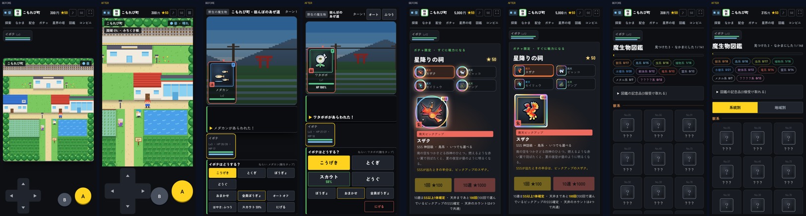

# ミチクサ鉄道 大型アップデート 納品報告

- 作業ブランチ: `claude/michikusa-big-update`（**main には一度も push していない。公開・デプロイもしていない**）
- 作業環境: クラウドのコンテナ（Linux、GPUなし）。導入したもの: Playwright（同梱）、Pillow、ffmpeg、matplotlib。
- 有料APIの利用: **$0**（画像・音声の生成AIは使っていない。docs/update/COST.md）
- 最終監査: **8.5/10、出荷を止めるものなし**（第1回 6.5 → 第2回 7.5 → 第3回 8.5。docs/update/AUDIT.md）
- テスト: `node tools/test/run.js` で **64件すべて合格**（アップデート前はテストなし）

（左から マップ・戦闘・ガチャ・図鑑。各組の左がアップデート前、右がアップデート後。全40組は [compare/](compare/)）

---

## 1. 何が変わったか

### 新しいシステム（DESIGN.md の Top 8、すべて実装済み）

| | 施策 | 中身 |
|---|---|---|
| T1 | 空もよう | 天気7種（晴れ・くもり・雨・霧・雪・火山灰・星降り）。天候限定の新種7体。駅の予報「みちくさ便り」。雨音とBGMのこもり |
| T2 | みちくさ踏破 | 4×4マスの区画ごとの足あと、踏破率、しかけスタンプ18種、みちくさ帳（点で交換）、寄り道ボーナス（最大 +50%、駅で0） |
| T3 | きらり | 踏むとレア確定・色違いが出やすくなる光。色違いの前兆と登場演出。メタルに逃げられたときの救済 |
| T4 | 地域図鑑 | 町ごとの図鑑とコンプ報酬、記念品を全種まで延長、はじめて会った場所・時間・天気の記録 |
| T5 | 戦闘UI | 主コマンドを 2×2 の大ボタンに。敵HPの表示、ダメージの数字、ヒットストップ、結果画面のカウントアップと「次の目標」 |
| T6 | 序盤の安心設計 | 初戦の補正、ぬし前は負けても0円（後は1/4）、会話スキップ、イボテにLv1の攻撃技 |
| T7 | マップの大画面化 | 地図が画面の71%（以前は約50%）、十字キー62px、時間帯・天気の帯 |
| T8 | まぼろし駅 | 霧の夜だけ停まる隠し駅（60×50）。幽霊列車と霧の足場のしかけ、新種マボロシャショウ、専用BGM |

### 天気の決め方（監査を受けて2回見直した）
天気は「実際の日付＋町＋時間帯＋その日の旅の日数（ゲーム内で夜→朝になるたびに進む。1日3日分まで）」で決まる。

- 1日に最大12コマの天気が出る。休み続けても同じ並びを繰り返すので、何度でも振り直すことはできない。「雨の日に来る」理由が残る。
- まぼろし駅に入れる日は 78%（霞ヶ丘だけで）。天候限定7種には、1日12コマ遊べば7日以内に全種100%会える。

### 魔生物の絵（ART_BIBLE.md）
- 3つの方向性を試作して比べ、**B案「トイ・フィギュア」**（太ふち6px・照り線・つや・右下の青い逆光）に決めた。CLAUDE.md の「立体フィギュア調」の範囲内。
- **既存159種をすべて描き直し**、新種8体（天候7＋まぼろし1）を加えて **167種**。目のなかった103種に目を入れた。
- 色違いは、色をずらすだけ（hue-rotate）をやめた。系統ごとに配色の型を3種用意し、種ごとに割り当てて、金の逆光ときらめきを付けた。
- 四神は、覚醒するとシルエットが育つ。
- 監査で「かっこよくない」「既存IPに似ている」とされた18体（覚醒形を含む）は、作り直した。「ホウオウ」は「ホウライ」に改名した（id は変えていないので、セーブはそのまま使える）。
- 自動の規格チェック（`node tools/art_check.js`）で、167種すべて合格。一覧: [after/art_all_normal_192_00.png](after/art_all_normal_192_00.png) ほか

### 音（AUDIO.md）
- BGMと効果音の音量を、それぞれ5段階で選べるようにした。効果音を約22種、ジングルを5種（勝利・レア・色違い・覚醒・新駅）追加した。
- 状況でBGMが変わる（夜・ぬし戦・HP3割以下・雨・霧）。
- マスターにコンプレッサーとリミッターを入れた。全31曲の音量差は 0.07dB 以内。ループの継ぎ目のクリックもなくした。
- 効果音がBGMに埋もれていたので、BGMを基準に調整した（例: 選択音 −38 → −0.6 LU、見せ場の音 +4〜5 LU）。
- 音はすべてゲーム内の Web Audio 合成で、外部の素材は使っていない。出どころは assets/audio/_provenance.csv（61件）。

### バランス（BALANCE.md）
本物のゲーム関数を動かすモンテカルロシミュレータ（`node tools/sim/run.js`）で測ってから調整した。

| 項目 | アップデート前 | 後 |
|---|---|---|
| 最初の草むらの初戦の勝率 | 20〜48% | 99% |
| 4戦目以降の勝率（相棒1体） | 26〜60% | 85〜89% |
| こもれび町のぬし（3体 Lv14） | 2% | 50% |
| メタル系を1体倒すまで | 約6時間 | 約1.3時間 |
| 天候限定種（狙った場合） | — | 5〜10分 |

---

## 2. 技術とセーブ互換

- セーブの形式は `state.v=1` のまま。新しいキーは、すべて `migrate()` と `fresh()` で補う。
  - アップデート前のセーブ（a4df3ae）と、作業途中の版のセーブの両方で、読み込み・引き継ぎコードの往復・`migrate` の冪等性を、テストと監査で確かめた。
- 歩けるマップのエンジン `src/parts/overworld.js` と `game.html` の同じ部分は、`python3 tools/check_sync.py` で一致を確かめている（作業前にあった1か所のずれも直した）。
- 踏破の到達性は、氷のすべり・押す岩・氷塊まで再現するソルバーで、全46マップを確かめている。まぼろし駅は「詰まない」ことも確かめた。
- サイズと速さ:
  - index.html は 762KB → 942KB（+24%）。
  - 起動してタイトルが出るまで（CPU 4倍遅い設定）: 646ms → 955ms（QA.md）。
  - 全種がそろった図鑑を初めて開くとき: 改修途中では 4.7秒かかっていたのを、0.03秒にした。
- 秘密情報のコミットはない（.gitignore に .env を追加）。

## 3. 追加したツール

| コマンド | 用途 |
|---|---|
| `node tools/test/run.js` | 回帰テスト64件（セーブ互換、T1〜T8、踏破ソルバー、にじみ検出など） |
| `node tools/shots.js docs/update/after` | 主要画面の撮影（`SHOT_W`/`SHOT_H` で画面サイズを変えられる） |
| `node tools/art_check.js` | 魔生物の規格チェック・一覧画像 |
| `node tools/sim/run.js <項目>` | バランスのシミュレーション |
| `node tools/audio_levels.js [--sfx]` | BGM・効果音の音量の測定 |
| `node tools/audio_preview.js` | 試聴用 mp3 の書き出し |
| `python3 tools/sync_ow.py` / `check_sync.py` | overworld.js の同期と検査 |

## 4. オーナーに確かめてほしいこと

1. **音を耳で聞いてほしい**: [audio_preview/](audio_preview/) に、主要8曲と、効果音をBGMに重ねた前後比較（`sfx_over_bgm_before/after.mp3`）がある。数値では確かめたが、誰も耳では聞いていない。
2. **実機で触ってほしい**: スマホ幅は Playwright で確かめたが、実機の操作感（十字キー、タップ移動）は未確認。
3. **公開するかどうか**: main へのマージと公開は、オーナーの判断を待って止めている。マージすると GitHub Pages の公開版が更新され、遊んでいる人には「新しい版があります」の案内が出る（推測。main の index.html が公開版である前提）。

## 5. 残っている課題（次回でよいもの）

監査の第3回で「低」とされたもの（ISSUES.md）:
- 図鑑の「出現」で、まだ開いていない町の名前が見える可能性がある（まぼろし駅以外。画面では未確認）。
- まぼろし駅は、霞ヶ丘に限らず、どの町でも霧の夜なら開く。
- 配合・祈りの場の背景に、放射グラデーションが残っている。使われていない古い CSS もある。駅の看板の角丸が大きい。
- 天候限定種に、狙わずに出会うのは16〜40分に1回（目標は約1時間。「狙えば会える」を優先した）。
- 1体の絵の作成は約12ms。図鑑一覧の画面組み立てに、約0.2秒（CPU 4倍遅い設定）かかる。

## 6. 次回アップデートの案

- **一般の進化**: 今回は見送った（DESIGN.md 6章）。T2 の踏破率・スタンプを進化の条件にすると、寄り道とつながる。
- **車窓イベント**: 電車での移動中に、窓の外の天気や魔生物が見える。予報と組み合わせると、次の行き先を決める楽しみが増える。
- **探索の分かれ道**: 町の「探索する」に、寄り道の選択肢を付ける。
- **天候と配合の連動**: 天候限定種どうしの特殊配合。
- **アニメーション**: 待機・攻撃のモーション（手続き描画のパーツを動かす）。

## 7. 作業の記録

| 文書 | 中身 |
|---|---|
| [RECON.md](RECON.md) | 偵察（技術、全システム、アセット、セーブ） |
| [DESIGN.md](DESIGN.md) | ゲームデザインの改善案と Top 8 の仕様 |
| [ART_BIBLE.md](ART_BIBLE.md) | アートバイブル（3案の比較と確定版） |
| [BALANCE.md](BALANCE.md) | バランスの測定と調整（グラフつき） |
| [AUDIO.md](AUDIO.md) | 音の測定と仕組み |
| [QA.md](QA.md) | QA の結果 |
| [AUDIT.md](AUDIT.md) | 監査 3回分と対応 |
| [DECISIONS.md](DECISIONS.md) | 指揮官が決めたこと（1行1件） |
| [PATCH_NOTES.md](PATCH_NOTES.md) | プレイヤー向けのパッチノート案 |
| [PROGRESS.md](PROGRESS.md) / [ISSUES.md](ISSUES.md) / [COST.md](COST.md) | 進捗・課題・費用 |
